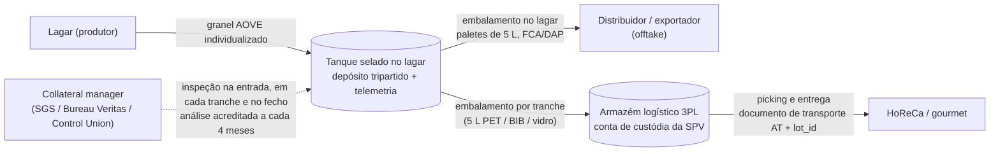
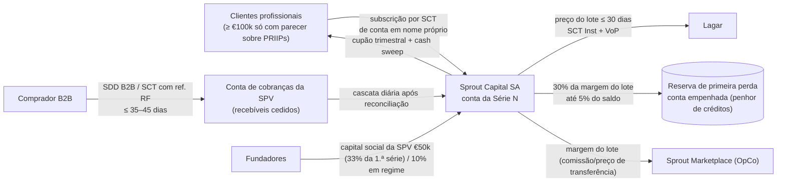
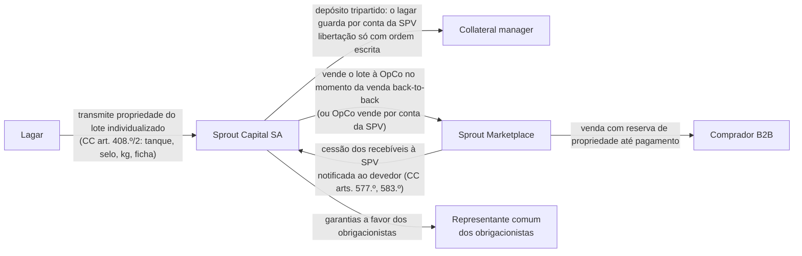

# 01 — Desenho do modelo de negócio (recomendação)

> **Data:** 13-10-2026. **Para:** fundadores do Sprout (Gonçalo Almeida, Pedro Marques, Speaker 1, Speaker 2) e quem escrever o business plan, o resumo em PDF e a webapp.
> **Base numérica:** `00-base-factual.md` (factos e fontes) e `docs/business-plan/modelo/pressupostos.json` (pressupostos). Todos os números deste documento saem desses dois ficheiros; os cálculos foram feitos com os mesmos parâmetros do JSON e reproduzem-se com `docs/business-plan/modelo/calculo_referencia.py`.
> **Revisão de 13-10-2026:** números refeitos depois da verificação registada em `00-base-factual.md` (secção "Registo de verificação"): referência HoReCa 5,65 €/kg, distribuidores ao preço de saída do embalador, piloto de 1 lote de 20 t, sem obrigações antes de 12 meses de registo da SPV (CSC art. 348.º/2), PRIIPs e classificação de investidores.
> **Etiquetas:** [F] facto com fonte; [L] referência legal/técnica não relida online; [E] estimativa nossa; [I] inferência/opinião nossa; NV não verificado.
> **Tom:** isto é a opinião de um conselheiro, não um parecer jurídico. Onde a tese do documento-fonte não fecha, dizemo-lo e propomos o que muda.

---

## Sumário para os fundadores

1. **A tese não se mede em "% redistribuído".** "80–90% da margem do embalador" não pode ser o que o Sprout guarda: essa margem vale 0,19–0,50 €/kg [F] e um desconto de 10% sobre a referência-base de 5,65 €/kg custa 0,57 €/kg. A "taxa de redistribuição do bolo" também não serve: é quase tautológica (1 − atrito ÷ bolo) e dá 70–90% mesmo em lotes que perdem dinheiro. **Medir por margem de contribuição em €/kg e por EBITDA.** No lote-tipo HoReCa em regime, o bolo de intermediação (1,22 €/kg) reparte-se em **46% desconto ao comprador, 4% cupão, 21% custos diretos e 28% margem do Sprout (0,35 €/kg)**.
2. **O desconto de 10% cabe à justa; o de 15% não.** Contra a referência-base de **5,65 €/kg** (equivalente de retalho *standard* a out. 2026, NV), a margem HoReCa em regime é **6,8% (0,35 €/kg)** com 10% de desconto e **1,4%** com 15%. Só contra **6,00 €/kg documentados** (origem identificada; cenário otimista) chega a 12,2%. Aos distribuidores não há desconto possível: a referência deles é o preço de saída do embalador (4,16–4,51 €/kg) e o canal fica perto do *break-even* (~1,5%).
3. **"Liquidação a 18 meses" é o vencimento legal das obrigações, não o tempo de detenção do azeite.** O lote roda em 2–6 meses (a parte HoReCa até ~6 meses enquanto houver < 300 clientes); o produtor recebe em ≤ 30 dias; o comprador paga em ≤ 35–45 dias; o investidor tem vencimento esperado a 12 meses e final a 18. Segurar azeite 18 meses custa ~20% em carry e arrisca 37–57% em preço [E].
4. **Estrutura da fase 1:** Sprout Marketplace (OpCo PT, **principal** no azeite, **agente com faturação direta** na água) + Sprout Capital, SA (SPV PT, capital social de €50k, que emite obrigações **só a investidores qualificados ou com subscrição ≥ €100.000**). Pelo CSC (art. 348.º/2 [L]), a SPV **só pode emitir 12 meses depois do registo definitivo**, salvo garantia bancária. Quem subscreve ≥ €100k sem ser profissional é retalho para os PRIIPs: **a 1.ª série vai só a profissionais**. Sem retalho abaixo de €100k, sem "jogadores", sem gamificação, sem "reembolso garantido".
5. **Piloto (01-02 a 31-07-2027):** 3 lagares + 2 engarrafadores, ~36 compradores, **1 lote misto de 20 t** (4 t HoReCa/*gourmet* + 16 t para distribuidores com *offtake*) + 60 paletes de água, **~€106k de GMV**, **financiado por capital próprio** (incl. os €50k de capital da SPV). Sem investidores no piloto: a 1.ª série (€150k = €100k sénior + €50k de capital da SPV) sai em nov. 2027–jan. 2028, depois do gate (31-08-2027).
6. **Economia a 5 anos: nenhum cenário chega ao *break-even* até 2031.** Base: 2.200 t de azeite e €11,1M de GMV em 2031, margem do azeite de 2,7% do GMV (0,12 €/kg), **EBITDA de −€1,22M em 2031** e necessidade de capital próprio **≥ €5,5M, ainda a crescer**. Otimista: EBITDA de −€0,91M em 2031. Pessimista: **parar no gate**. Para pagar a estrutura de 2031, a margem média do azeite teria de ser ~0,68 €/kg. **O plano não é financiável tal como está**: o piloto tem de provar outro preço ou permitir outra estrutura (secção 7.4).
7. **Os maiores riscos não são de mercado:** promoção a retalho, *backoffice* "reverse engineered", conflito de interesses com o lagar âncora, um parecer jurídico que não é independente e uma emissão antes do prazo do CSC.

---

## 1. Interpretação da tese

### 1.1 O que o documento-fonte afirma

| Afirmação | Texto do documento-fonte | Problema |
|---|---|---|
| Captura de margem | "80–90% — Margem do embalador capturada" | A margem líquida do embalador é 0,19–0,50 €/kg (4,9–14,1% do PVP s/ IVA) [F]; os embaladores operam com EBITDA de 5–6% [F] |
| Desconto | "10–15% — Desconto ao cliente vs. mercado" | "Mercado" não está definido. Contra marca branca espanhola (3,99–4,57 €/kg s/ IVA) [F] o desconto é impossível |
| Liquidação | "Ciclo de 18 meses — janelas previsíveis de liquidação com extensão e *refunding*" | Pagar ao produtor a 18 meses é proibido (≤ 30/60 dias, Dir. 2019/633) [F]; segurar azeite 18 meses é especulação [E] |
| Hedging | "Spread operacional retido com hedging"; "hedge funds/taxas de cobertura" | Não há futuros de azeite desde o fecho do MFAO (2016–17) [F] |
| Investidores | "HNWIs", "investidores não sofisticados (jogadores)" | Retalho com retorno prometido = reserva bancária, MiFID, PRIIPs, precedentes Afinsa/Asset Land [F] |

### 1.2 Leitura coerente: um único fluxo de mercadoria e de dinheiro

**Definições que propomos adotar em todos os documentos:**

- **Bolo de intermediação (Π)** = preço de referência que o comprador paga hoje pelo produto equivalente − preço do granel ao lagar − custo físico de embalamento − custo físico de logística. É o que hoje fica com embalador, distribuidor e retalhista (margens e despesas gerais).
- **Repartição do bolo** = desconto ao comprador, cupão, custos diretos (custódia, 3PL, análises, armazenagem, perdas, crédito, pagamentos) e margem do Sprout, em €/kg e em % de Π. **Serve para explicar, não para medir.** A antiga "taxa de redistribuição" ((desconto + margem + cupão) ÷ Π) é ≈ 1 − atrito ÷ Π: dá 70–90% tanto em lotes viáveis como em lotes com margem negativa (secção 2.5) e conta o cupão, que é custo de financiar stock (os incumbentes também o suportam dentro de Π), como "redistribuição". **A tese mede-se por margem de contribuição em €/kg, por canal, e por EBITDA.**
- **Desconto** = diferença, em €/kg, entre a referência **observada e documentada** (cotação de cash & carry, *foodservice* ou lista do concorrente para o produto equivalente) e o preço Sprout. Meta: **10%** a HoReCa e lojas *gourmet*; **0%** a distribuidores e exportadores, cuja referência é o preço de saída do embalador (o argumento para eles é origem verificada, lote e prazo, não preço).
- **Ciclo de 18 meses** = vencimento legal das obrigações da Sprout Capital. Vencimento esperado em **M12** (uma campanha); **uma** extensão condicionada até **M18**. O ciclo físico de cada lote é de **2–6 meses**.
- **"Refunding"** = palavra só de uso interno, no sentido técnico de **refinanciamento** de uma série por outra. Em materiais externos: "mecanismos de liquidez e extensão".

### 1.3 Os três lados e a plataforma

| Lado | Quem | O que dá | O que recebe | Contrato |
|---|---|---|---|---|
| **Produtores** | Lagares do Alentejo e Trás-os-Montes (âncora: Lagar do Val + 2); engarrafadores com captação reconhecida pela DGEG; na fase 2, importadores de café verde da UE | Lote individualizado, ficha analítica, embalamento no lagar, telemetria do tanque | Preço = índice (média 2 semanas SIMA + Poolred) + prémio de origem; **pagamento ≤ 30 dias por SCT Inst** | Produtor↔Sprout: compra, depósito tripartido, força maior com lista fechada |
| **Compradores B2B** | HoReCa média/alta, lojas *gourmet*, distribuidores *foodservice*, exportadores | Encomenda firme ou *offtake*; mandato SDD B2B | HoReCa/*gourmet*: azeite de origem rastreável com ~10% de desconto sobre a referência documentada. Distribuidores: preço de saída do embalador, lote verificado e prazo. Entrega e crédito a 30–45 dias | Condições gerais de venda; *offtake* acima de 10 t |
| **Financiadores** | Fase 1 (desde a 1.ª série, nov. 2027–jan. 2028): clientes profissionais; subscritores ≥ €100k não profissionais só se o parecer afastar o KID PRIIPs. Fase 2: banco parceiro (financiamento de stock de terceiros) | Capital para stock e recebíveis | **Cupão fixo de 8%/ano** (base 2028, 1.º ano com obrigações), garantido por penhor/propriedade dos lotes e cessão de recebíveis; sem participação no preço do azeite | Termos e condições das obrigações; representante comum |
| **Plataforma** | **Sprout Marketplace** (OpCo), **Sprout Capital, SA** (SPV), *collateral manager* independente | Curadoria, verificação, custódia, logística, crédito, *ledger* e reconciliação diária | Margem de principal; comissão de agente na água; comissões de verificação (fase 2) | — |

### 1.4 Fluxos

**Mercadoria (azeite, modelo principal)**

Libertar o lote encomenda a encomenda sob custódia de terceiro (centenas de libertações por lote: a parte HoReCa sai em encomendas de 20–50 kg) não cabe em €1.200 por lote. Por isso a parte HoReCa é embalada por tranches e passa para um 3PL com conta de custódia: €2.000 de *collateral manager* por lote (entrada, ~3 tranches, fecho) e 0,06 €/kg de armazenagem e *picking* no 3PL [E, NV]. Cada +0,05 €/kg nestes custos = −€20,5k de EBITDA em 2031 (base, 410 t).

**Dinheiro**

**Título e colateral**

**Água (modelo agente com faturação direta)**

Sem fundos de terceiros na Sprout, sem stock, sem depósitos SDR no balanço e sem necessidade de PSP *marketplace* [I].

### 1.5 Calendário de um lote misto (base, regime)

| Dia | Evento | Dinheiro | Título |
|---|---|---|---|
| D−30 | *Offtake* de distribuidores e encomendas HoReCa cobrem ≥ 85% do lote; análise de pré-compra | — | Lagar |
| D0 | Tanque selado, inspeção de entrada, ficha do lote; utilização da série | Compromisso de pagamento ao lagar | **SPV** |
| D0–D60 | Distribuidores levantam as paletes do *offtake* | — | SPV → OpCo → distribuidor em cada expedição |
| D0–D90 | Parte HoReCa: embalamento por tranche, inspeção e libertação para o 3PL; entregas; faturas com ref. RF | — | SPV (no 3PL) → OpCo → comprador em cada entrega |
| D30 | Pagamento ao lagar | SCT Inst (SPV → lagar) | — |
| D35–D125 | Cobranças SDD B2B / SCT | Comprador → conta de cobranças → cascata diária | — |
| D125 | Lote fechado; capital reutilizado no lote seguinte ou amortizado (*cash sweep*). Com < 300 clientes HoReCa, a parte HoReCa pode levar ~6 meses (fecho em ~D215) | — | — |
| M12 / M18 | Reembolso esperado da série / vencimento legal | SPV → investidores | — |

No piloto (fev.–jul. 2027) o calendário é o mesmo, mas sem série: o lote é pago com capital próprio, porque a SPV só pode emitir obrigações 12 meses depois do registo (secção 3.2).

---

## 2. Aritmética com números reais

### 2.1 Pressupostos do lote-tipo (base; regime = 2029, piloto = 2027)

| Parâmetro | Valor | Origem |
|---|---|---|
| Preço do granel ao lagar | 3,60 €/kg = índice 3,50 + prémio 0,10 | Índice definido (média SIMA + Poolred) a out. 2026 = 3,42–3,47 €/kg: SIMA PT 3,40–3,80 (início out. 2026) e Poolred 3,34 [F]; os 3,50 da sem. 39/2026 são cotação Oleista. O modelo usa 3,50, arredondado para cima (conservador) — `00-base-factual.md` §1.2 |
| Embalamento no lagar | 0,55 €/kg | Observatorio 0,47–0,51 €/kg [F] + mix com vidro [E] |
| Logística até HoReCa | 0,28 €/kg (2029); 0,30 (2027) | 0,15–0,30 €/kg [E] |
| Armazém logístico (3PL) e *picking* | 0,06 €/kg | [E, NV] encomendas de 20–50 kg a ~€2–4 cada |
| Armazenagem / seguro / análises | 4 €/t/mês e 0,2%/ano sobre o **stock médio** (45 dias em regime; 180 dias com < 300 clientes); 2 × €300 por lote | [E] `40-risco-coberturas.md` §5.2 |
| Perdas / desclassificação esperada | 0,5% uma vez; 3% por trimestre × 0,30 €/kg | [E] idem |
| Custódia (*collateral manager*) | €2.000 por lote: entrada + ~3 libertações de tranche para o 3PL + fecho | [E, NV] €300–500 por visita |
| Pagamentos bancários | 0,01 €/kg | [E] comissões SEPA por operação; KYC e faturação estão no custo fixo de tecnologia |
| Provisão de crédito | 0,6% das vendas | [E] com SDD B2B |
| Financiamento | Regime: cupão 7,5%/ano (2029); 90% do capital em obrigações; utilização 80%; ciclo líquido 50 dias (45 stock médio + 35 recebimento − 30 pagamento). **Piloto: sem obrigações** (capital próprio) | [E]; CSC art. 348.º/2 [L] |
| **Preço de referência do comprador** | **5,65 €/kg s/ IVA** (≈ 5,18 €/L; ≈ 5,49 €/L c/ IVA) | **[E] NV**: equivalente de retalho *standard* a out. 2026. Retalho PT 6,67 €/kg com granel a 4,43 (abr. 2026) [F] ajustado ao granel de 3,50–3,60: rácio 0,664 ⇒ 5,27–5,42; diferencial constante de 2,24 €/kg ⇒ 5,74–5,84; base = ponto médio de 5,3–6,0. **6,00 €/kg só no otimista**, com cotações documentadas de origem identificada |
| Desconto | 10% | Documento-fonte (limite inferior) |

### 2.2 Lote de 20 t de AOVE (HoReCa/gourmet)

| Linha | Regime 2029: € (20 t) | €/kg | Piloto 2027: €/kg |
|---|---|---|---|
| Valor à referência (5,65 €/kg) | 113.000 | 5,650 | 5,650 |
| Desconto ao comprador (10%) | −11.300 | −0,565 | −0,565 |
| **Receita Sprout** | **101.700** | **5,085** | **5,085** |
| Compra do granel ao lagar | 72.000 | 3,600 | 3,600 |
| Embalamento | 11.000 | 0,550 | 0,550 |
| Logística | 5.600 | 0,280 | 0,300 |
| Armazém logístico (3PL) e *picking* | 1.200 | 0,060 | 0,060 |
| Armazenagem (stock médio 45 dias; piloto 180) | 120 | 0,006 | 0,024 |
| Seguro do stock | 18 | 0,001 | 0,004 |
| Análises (entrada + intermédia) | 600 | 0,030 | 0,030 |
| Perdas físicas | 360 | 0,018 | 0,018 |
| Desclassificação esperada | 90 | 0,005 | 0,018 |
| Custódia e libertações por tranche | 2.000 | 0,100 | 0,100 |
| Pagamentos bancários | 200 | 0,010 | 0,010 |
| Provisão de crédito | 610 | 0,031 | 0,031 |
| Cupão das obrigações (90% do capital; 50 dias) | 959 | 0,048 | 0 (sem obrigações) |
| Custo de cobertura explícito | 0 | 0 | 0 |
| **Total de custos diretos** | **94.757** | **4,738** | **4,744** |
| **Margem de contribuição do Sprout** | **6.943** | **0,347 (6,8%)** | **0,341 (6,7%)** |
| Retida na reserva de primeira perda (30% da margem; teto 5% do saldo = €4.669) | 2.083 | 0,104 | — |
| Margem livre para a OpCo após reserva | 4.860 | 0,243 | — |
| *Memo:* custo nocional do capital próprio a 8% (fora do EBITDA) | — | 0,005 (10% do capital) | 0,168 (100% do capital) |

**Do lado do investidor (regime 2029, base):** o lote imobiliza €83.000 (granel + embalamento) durante ~50 dias. Com 90% do capital em obrigações e utilização média de 80%, a série tem **€93.375 de obrigações** afetas ao lote (o excedente fica em caixa na série); o cupão do ciclo é **€959** (7,5%/ano bruto; ~5,4% líquido para um particular residente, retenção de 28% [L]). Os outros 10% (€8.300) são capital subordinado do patrocinador, cujo custo é nocional. O investidor não ganha nem perde com o preço do azeite enquanto a almofada (subordinado + reserva) absorver as perdas.

**No piloto (fev.–jul. 2027) não há obrigações:** a SPV só pode emitir 12 meses depois do registo definitivo (CSC art. 348.º/2 [L]). O stock é capital próprio, e o seu custo nocional (0,17 €/kg a 8% durante 185 dias) corta a margem económica da parte HoReCa para metade (~0,17 €/kg).

### 2.3 Repartição do bolo de intermediação

Π = 113.000 − 72.000 − 11.000 − 5.600 = **€24.400 (1,22 €/kg)**.

| Destino | € | €/kg | % de Π |
|---|---|---|---|
| Comprador (desconto) | 11.300 | 0,565 | 46,3% |
| Investidores (cupão: custo de financiar stock, que os incumbentes também suportam dentro de Π) | 959 | 0,048 | 3,9% |
| Custos diretos: 3PL, custódia, análises, armazenagem, perdas, crédito, pagamentos | 5.198 | 0,260 | 21,3% |
| Sprout (margem de contribuição) | 6.943 | 0,347 | 28,5% |
| **Total** | **24.400** | **1,220** | **100%** |

**Leitura.** No lote-tipo HoReCa, o bolo de intermediação (1,22 €/kg) reparte-se em 46% desconto ao comprador, 4% custo de capital, 21% custos diretos e 28% margem de contribuição do Sprout. À escala do plano (2031, base), essa margem, somada à dos distribuidores, que fica perto de zero, não paga a estrutura: **EBITDA de −€1,22M**. A antiga "taxa de redistribuição de 88%" não distinguia lotes viáveis de inviáveis (com referência 5,40 e 15% de desconto, o lote perde €2.898 e a "redistribuição" ainda dá 74%) e contava o cupão como redistribuição. Não a usar.

### 2.4 A leitura literal falha

Margem líquida do embalador × 20 t = €3.800 (0,19 €/kg) a €10.000 (0,50 €/kg) [F]. Capturar 80–90% dá **€3.040–9.000**. Só o desconto de 10% sobre 5,65 €/kg custa **€11.300** (15%: €16.950). **Com a definição literal, o desconto custa 1,3 a 5,6 vezes o que se captura.** O deck não pode usar "80–90% da margem do embalador" sem esta correção: seria uma afirmação enganosa perante investidores (Reg. 2017/1129, art. 22.º; CVM, art. 7.º; responsabilidade civil e penal do emitente [L]). A MiFID art. 24.º(3) aplica-se ao intermediário, se houver um.

### 2.5 Sensibilidade (lote de 20 t, regime 2029)

| Referência do comprador | Desconto | Receita | Margem Sprout | % | €/kg | Π (€/kg) | Sprout / Π |
|---|---|---|---|---|---|---|---|
| Origem identificada, 6,00 €/kg (só otimista) | 10% | 108.000 | 13.205 | 12,2% | 0,66 | 1,57 | 42% |
| Origem identificada, 6,00 €/kg | 15% | 102.000 | 7.241 | 7,1% | 0,36 | 1,57 | 23% |
| **Base, 5,65 €/kg** | **10%** | **101.700** | **6.943** | **6,8%** | **0,35** | **1,22** | **28%** |
| Base, 5,65 €/kg | 15% | 96.050 | 1.327 | 1,4% | 0,07 | 1,22 | 5% |
| AOVE *standard*, 5,40 €/kg (rácio 0,664) | 10% | 97.200 | 2.470 | 2,5% | 0,12 | 0,97 | 13% |
| AOVE *standard*, 5,40 €/kg | 15% | 91.800 | **−2.898** | −3,2% | −0,14 | 0,97 | −15% |
| Marca branca ES 1 L, 4,57 €/kg | 10% | 82.260 | **−12.381** | −15,1% | −0,62 | 0,14 | — |
| Retalho PT médio abr. 2026, 6,67 €/kg | 10% | 120.060 | 25.193 | 21,0% | 1,26 | 2,24 | 56% |
| Retalho PT médio abr. 2026, 6,67 €/kg | 15% | 113.390 | 18.563 | 16,4% | 0,93 | 2,24 | 41% |

**Desconto máximo compatível com cada margem-alvo:**

| Margem-alvo do Sprout | Referência 6,00 (origem, otimista) | **Referência 5,65 (base)** | Referência 5,40 (*standard*) |
|---|---|---|---|
| 0% (*break-even* do lote) | 21,1% | 16,2% | 12,3% |
| 5% | 16,9% | 11,7% | 7,7% |
| 10% | 12,2% | **6,8%** | 2,5% |

As linhas da referência 6,67 €/kg (retalho de abril) **não são referência HoReCa**: o granel caiu ~21% desde então (4,43 → 3,50) e a HoReCa compra abaixo do retalho. Não as usar no deck [I].

**Distribuidores/exportadores (regime 2029):** preço de venda 4,35 €/kg (preço de saída do embalador, sem desconto), custos diretos 4,286 €/kg, margem **0,064 €/kg (1,5%)**. O canal só não perde dinheiro com referência ≥ **4,29 €/kg**; cada 0,10 €/kg vale ~€178k de EBITDA em 2031 (base, 1.790 t). O granel em IBC fica fora do modelo de principal: negoceia-se ao índice (3,34–3,50 €/kg) + corretagem < 1%, sem custo de embalamento; vendê-lo a 4,35 seria cobrar 24–30% acima do índice.

### 2.6 E se o lote ficar 18 meses?

Carry a 18 meses ≈ **19,8%** do valor; VaR 95% de preço a 18 meses **37–57%** [E]. Contra uma margem de ~7%, a perda potencial é de **50–70% do lote**. Com azeite não há futuros para cobrir isto. **Detenção longa não é financiável sem passar o risco de preço para o investidor**, e isso transforma o produto em derivado ou FIA (`20-regulatorio.md` §2).

### 2.7 Lote de água (20 paletes = 15.000 L = 10.000 garrafas de 1,5 L)

| Linha | Principal, 10% | Principal, 15% | Agente (recomendado) |
|---|---|---|---|
| Valor à referência (0,40 €/L, **NV**) | 6.000 | 6.000 | 6.000 |
| Receita / GMV | 5.400 | 5.100 | GMV 5.400 |
| Preço ex-fábrica (0,24 €/L, média DGEG [I]) | 3.600 | 3.600 | — |
| Logística (troncal ~€200 + entrega 0,05 €/L) | 950 | 950 | — (engarrafador) |
| Operação, pagamentos | 150 | 150 | — |
| Financiamento (stock + depósitos, 30 dias) | 38 | 38 | — |
| Provisão de crédito | 32 | 31 | — |
| **Margem / comissão Sprout** | **630 (11,7%; 0,042 €/L)** | **332 (6,5%)** | **108 (2% do GMV; banda 0,5–3% [E])** |
| Depósito SDR a adiantar e reconciliar | 1.000 (19% da receita) | 1.000 | 0 |
| Margem de embalador capturável | **0** (embalamento na origem obrigatório [F]) | 0 | 0 |

**Leitura:** a percentagem parece aceitável como principal, mas o valor absoluto é irrelevante (como principal, €630 por 20 paletes, ou €31,5 por palete: 1,5 FTE, €72–85k com encargos, exigem ~2.300–2.700 paletes/ano; como agente a 2%, €5,4 por palete: ~13.300–15.700 paletes/ano, 7 a 9 vezes as 1.800 previstas para 2031), assume que um engarrafador vende a um comprador pequeno ao preço médio do mercado (improvável) e obriga a gerir depósitos SDR. **Não há margem de embalador a capturar e não há nada para financiar** (€3.600 de stock durante 30 dias). A água fica como **agente com faturação direta**, sem investidores, e com critério de saída no gate.

### 2.8 Veredicto: o que cabe e o que tem de ceder

**Cabem em simultâneo** "10% de desconto", "7,5–8% ao investidor" e uma margem HoReCa de **~7% (0,35 €/kg)** quando se verificam as cinco condições:
1. azeite de **origem identificada** (lagar, lote, ficha analítica; DOP/monovarietal quando houver);
2. vendido a compradores que hoje pagam **≥ 5,65 €/kg s/ IVA** pelo equivalente (referência documentada);
3. desconto de **10%**, não 15%;
4. **≥ 300 clientes HoReCa ativos** (stock médio ≤ 45 dias) e ≥ 85% do lote vendido *back-to-back*; abaixo disso, com obrigações, a margem HoReCa cai para ~0,15 €/kg;
5. produtor pago a preço de índice + prémio pequeno, e não acima do mercado.

**Uma margem de ~12% só existe com referência ≥ 6,00 €/kg documentada** (cenário otimista). Aos distribuidores, o Sprout vende ao preço de saída do embalador, com margem de ~1–2%: o canal serve para dar volume aos lotes (diluir custódia e análises) e historial para o financiamento de terceiros, não para ganhar dinheiro. **Mesmo com as cinco condições, a margem por kg não paga a estrutura do plano** (secção 7.4).

**Tem de ceder:**

| O quê | Como fica |
|---|---|
| "80–90% da margem do embalador" | "No lote-tipo HoReCa, o bolo de intermediação (1,22 €/kg) reparte-se em 46% desconto, 4% cupão, 21% custos diretos e 28% margem do Sprout. A tese mede-se por margem em €/kg por canal e por EBITDA" |
| "10–15% de desconto" | "Até 10% sobre uma referência documentada em €/kg (HoReCa/*gourmet*); 0% a distribuidores e exportadores (preço de saída do embalador); nunca contra marca branca" |
| "Liquidação a 18 meses" | "Vencimento esperado a 12 meses, legal a 18, com uma extensão condicionada" |
| "Refunding" | Reserva de primeira perda + extensão + *cash sweep* + refinanciamento voluntário |
| Água como "captura de margem" | Água como serviço de agente (~2%), sem tese de margem |
| AOVE *standard* para HoReCa | Fora: é o produto-chamariz do cash & carry |
| Granel em IBC "com margem" | Fora do modelo de principal: é corretagem ao índice |

---

## 3. Estrutura jurídica e regulatória

### 3.1 Matriz de opções

| Opção | Licença | Público | Limite | Custo inicial [E] | Prazo [E] | Risco regulatório | Encaixe na tese | Decisão |
|---|---|---|---|---|---|---|---|---|
| **A.** Marketplace agente com PSP *marketplace* | Do PSP | Empresas | — | €5–20k + PSP (Lemonway €5.490 + €840/mês) | 1–3 meses | Baixo | Baixo (comissão < 1–3%) | Só na água, e **sem PSP** (faturação direta) |
| **B.** OpCo principal (compra e revende) | Nenhuma | Empresas | Balanço | Baixo | 1–3 meses | Baixo | **Alto** | **Sim — azeite** |
| **C.** SPV PT (SA) emite obrigações a qualificados / ≥ €100k | Nenhuma em colocação direta pelo emitente | Profissionais; ≥ €100k por investidor (retalho para os PRIIPs) | Isenções do art. 1.º(4); CSC art. 348.º/2 | €15–40k + capital social €50k + ~€25k/ano + funções independentes ~€30k/ano | Constituição 1–2 meses; **1.ª emissão ≥ 12 meses após o registo definitivo**, salvo garantia bancária | Médio (parecer sobre FIA, RGICSF/CSC e PRIIPs) | **Alto** | **Sim — 1.ª série nov. 2027–jan. 2028** (ou abr. 2027 com garantia de instituição de crédito, custo NV a orçamentar) |
| **D.** Promotor em plataforma ECSP de terceiros | Do parceiro (CMVM) | Incl. não sofisticados | **€5M/12 meses** | Comissões NV + €10–20k | 3–6 meses | Médio | Médio (capital de retalho custa 10–13%/ano) | Fase 2+, só recebíveis ou lotes diferenciados |
| **E.** FIA + AIFM | AIFM | Profissionais | Limiares AIFMD | €100–250k + €80–200k/ano | 3–9 meses | Baixo, mas pesado | Médio | Não (só acima de €10–20M) |
| **F.** Licenças próprias (IP/IME/ECSP) | Sprout | Conforme licença | — | €150–500k + equipa | 9–18 meses | Baixo, mas lento | Baixo | Não |
| **G.** Venda direta a "jogadores" com retorno | — | — | — | — | — | **Crime** (RGICSF art. 200.º) | — | **Proibido** |
| **H.** Veículo ou *token* fora da UE | Local | Na UE, os mesmos limites | MiCA/MiFID | Baixo à entrada | Anos para banca UE | Alto | — | **Não** |
| **I.** Banco parceiro como mutuante; Sprout origina e verifica | Do banco | Lagares (crédito) | Apetite do banco | Jurídico €10–20k | 4–9 meses | Baixo | **Alto (fosso)** | **Fase 2 (2028)** |

### 3.2 Decisão para a fase 1

| Entidade | Forma | Papel | Notas |
|---|---|---|---|
| **Sprout Marketplace** (OpCo) | Lda ou SA (SA se houver rondas de capital) | Principal no azeite; agente na água; *servicer* da SPV; emite faturas por software certificado AT | Contas bancárias: operação + reserva de IVA |
| **Sprout Capital, SA** (SPV) | SA, detida pela OpCo, **constituída e registada até nov. 2026**, com capital social de **€50.000** (mínimo legal, CSC art. 276.º/5 [L]; ≥ 30% realizado na constituição, art. 277.º/2 [L]; integralmente realizado antes da 1.ª emissão, a confirmar no parecer) e 1 administrador independente | Compra e detém os lotes individualizados; emite obrigações por série; recebe as cobranças (recebíveis cedidos) | Uma conta bancária por série; representante comum dos obrigacionistas (CSC art. 357.º ss. [L]); cláusulas de *limited recourse* e *non-petition*; ROC. O capital social é o subordinado da 1.ª série |
| *Collateral manager* | Contrato com inspetora independente | Detém por conta da SPV; certifica existências; inspeção na entrada e libertação | Nunca o lagar âncora sozinho |

**Porque não FIA [I, a confirmar no parecer]:** a SPV tem finalidade comercial (compra e vende mercadoria a clientes reais com risco comercial), paga **cupão fixo** e não um retorno agregado indexado ao desempenho dos lotes, e não tem política de investimento discricionária. **Porque não captação ilícita de fundos reembolsáveis:** emite obrigações nos termos e limites do CSC (exceção do RGICSF art. 9.º [L]). Esses limites incluem o art. 348.º/2 do CSC [L]: só emitem obrigações sociedades com contrato definitivamente registado há mais de um ano, salvo (a) fusão ou cisão com sociedade registada há mais de um ano, (b) maioria do capital detida pelo Estado ou (c) obrigações garantidas por instituição de crédito ou pelo Estado. Uma emissão da SPV antes de 12 meses de registo, sem garantia bancária, sai da exceção e cai no risco do art. 200.º. Por isso a pergunta 2 do parecer é **condição prévia (go/no-go) da 1.ª emissão** (redação em vigor a reconfirmar no DRE). **Porque não derivado:** o investidor não recebe diferenças de preço do azeite; recebe juro.

**Atenção ao Regulamento de Titularização (UE) 2017/2402** [L]: subordinar o patrocinador sobre uma carteira que inclui recebíveis pode configurar *tranching*. O parecer tem de o afastar (por exemplo, estruturando o subordinado como capital ou suprimentos da OpCo e não como *tranche*).

### 3.3 Públicos permitidos no piloto e na 1.ª série

| Público | Permitido? | Condição |
|---|---|---|
| Compradores | Sim | Só empresas e ENI com NIF e atividade; KYB; SDD B2B |
| Produtores | Sim | Lagares licenciados; engarrafadores com captação reconhecida; KYB; IBAN validado por VoP |
| Investidores profissionais *per se* (MiFID II, Anexo II, I) | Sim (1.ª série, após o gate) | Documentar a categoria |
| Profissionais a pedido | Só se já classificados | Só se o investidor já estiver classificado como cliente profissional por um banco ou empresa de investimento. Guardar a declaração escrita dessa entidade (Reg. 2017/1129, art. 2.º, al. e) [L]). O Sprout não aplica o teste do Anexo II por si: a SPV e a OpCo não são intermediários financeiros e não podem fazer o *opt-up*. Na falta dessa classificação, só com subscrição ≥ €100.000 (art. 1.º(4)(d)) |
| Qualquer investidor com subscrição ≥ €100.000 | Sim, mas é **investidor de retalho** (PRIIPs/MiFID) | Art. 1.º(4)(d) Reg. Prospetos dispensa o prospeto, não o KID: exige KID se as obrigações forem PRIIP (provável com *limited recourse* aos lotes; Reg. 1286/2014, arts. 4.º(1) e 4.º(6) [L]); KYC e origem de fundos. **Na 1.ª série, não aceitar** sem parecer que afaste o KID |
| "HNWI" sem estes critérios | **Não** | "Rico" não é "qualificado" |
| **Retalho abaixo de €100k / "jogadores"** | **Não** | Ver abaixo |
| Investidores fora de PT | Não no piloto | *Reverse solicitation* não serve; exige análise local |
| Residentes ou fundos de países da lista UE de alto risco | Não | Lista atualizada a 29-01-2026 [F] |

**Porque os "jogadores" ficam fora — sete razões:**
1. **Reserva bancária:** qualquer promessa de retorno fixo a retalho com "*refunding*" (por exemplo, "entregue €X; devolvemos €X + y%; se correr mal fazemos *refunding*") é captação de fundos reembolsáveis; fora das obrigações emitidas nos termos e limites do CSC, é crime (RGICSF art. 200.º) [F/L]. Os 10–15% do documento-fonte são desconto ao cliente, não retorno ao investidor: não os misturar.
2. **Precedentes:** Afinsa/Fórum Filatélico (ativo tangível + recompra prometida; penas até 12 anos), Asset Land e Capital Alternatives (lotes individuais e colheitas = OIC), Cimovelpark (alerta CMVM) [F].
3. **Retalho exige** plataforma ECSP (teto €5M/ano, teste, simulação de perdas, 4 dias de reflexão, KIIS), intermediário autorizado ou prospeto, e KID PRIIPs [F].
4. **Gamificação** é alvo declarado da ESMA (DP ESMA35-43-3682) e da IOSCO; a diretriz aprovada no documento-fonte já a proíbe [F].
5. **Custo de capital:** o capital de retalho via ECSP custa 10–13%/ano [E], o que consome a margem inteira de um lote *standard*.
6. **Rails:** os PSP proíbem ou restringem investimento e *crowdfunding* nas AUP; descobrir o fluxo *a posteriori* = conta congelada ("dinheiro preso") [F].
7. **Reputação:** um único alerta CMVM fecha bancos e investidores qualificados para o resto do projeto.

**Para o futuro (fase 2+), duas vias limpas:** (a) promotor numa ECSP de terceiros (Raize tem autorização ECSP [F]; Goparity e Miimosa a verificar), só para recebíveis curtos ou lotes diferenciados; (b) "adoção" ou pré-compra de colheita **com entrega em espécie e sem *cash-out***, ao estilo CrowdFarming, para consumidores e pequenos clientes (confirmar regime de recompensa da Lei 102/2015).

### 3.4 Jurisdição

- **Fase 1: Portugal** para OpCo e SPV. Rails bancários UE sem risco de repatriação; custo de €15–40k e 1–2 meses para constituir [E]; a 1.ª emissão só 12 meses após o registo definitivo (CSC art. 348.º/2 [L]).
- **Escala (> €5–10M de obrigações e investidores internacionais):** veículo de titularização luxemburguês por compartimentos; sem autorização CSSF enquanto não houver emissões contínuas ao público [F].
- **Rejeitar** estruturas fora da UE e *tokens*: BVI na lista UE de alto risco desde 29-01-2026; MiCA/MiFID aplicam-se onde está o investidor; banca UE com diligência reforçada [F].

### 3.5 Perguntas para o parecer jurídico (antes do primeiro euro de investidor)

O parecer tem de ser **escrito, assinado por advogado independente** (não por um sócio do projeto) e sobre o *term sheet* final:
1. A SPV é FIA à luz das orientações ESMA/2013/611?
2. **(Condição go/no-go da 1.ª emissão.)** A emissão cabe na exceção do RGICSF art. 9.º (obrigações "nos termos e limites do CSC")? Confirmar a redação em vigor do CSC art. 348.º/2 (1 ano de registo definitivo; exceções: fusão/cisão, maioria pública, garantia de instituição de crédito ou do Estado), se o capital tem de estar integralmente realizado antes de deliberar a emissão, e o custo de uma garantia bancária para emitir antes de nov. 2027.
3. Isenção de prospeto aplicável (art. 1.º(4)(a) e (d)); como documentar a classificação de profissionais a pedido feita por bancos ou empresas de investimento (art. 2.º, al. e)); se a CMVM exige documento informativo abaixo de €12M; regras de publicidade da oferta isenta (Reg. 2017/1129, art. 22.º; CVM, art. 7.º).
4. Quem pode comercializar as obrigações: só a administração da SPV? A OpCo pode apresentar o produto sem licença MiFID?
5. Venda SPV→OpCo vs. comissão (Código Comercial art. 266.º [L]): efeitos em IVA, faturação e insolvência.
6. Transmissão de propriedade e penhor de coisa genérica depositada no lagar e no 3PL; armazéns gerais e *warrant*; contrato de depósito tripartido; garantia sobre a conta da reserva: penhor de direitos de crédito (CC arts. 679.º ss.) ou penhor financeiro (DL 105/2004 só se o beneficiário ou o agente de garantias for instituição de crédito ou outra entidade do art. 2.º).
7. Regulamento de Titularização: o subordinado do patrocinador cria *tranching*?
8. Financiar stock de terceiros (fase 2): reserva de concessão de crédito; estrutura com banco mutuante.
9. Retenção na fonte sobre juros e regime fiscal da SPV.
10. **As obrigações da Sprout Capital são PRIIP** (montante reembolsável exposto ao desempenho de lotes que o investidor não adquire diretamente; Reg. 1286/2014, art. 4.º(1))? Se sim: KID e responsabilidade do produtor para os subscritores não profissionais (via ≥ €100k e via < 150 pessoas). Até haver resposta, a 1.ª série vai só a profissionais.

### 3.6 PSP/IME e bancos (lista curta)

| Função | Fase 1 (recomendado) | Alternativa / fase 2 | Excluir |
|---|---|---|---|
| Contas da OpCo (cobrança e pagamento) | Banco PT com SCT Inst + VoP, ID de credor SDD B2B e extratos camt.053 (pedir a 2–3 bancos; disponibilidade de camt.053 **NV**) | — | — |
| Contas da SPV (uma por série) | Banco PT diferente do da OpCo, com o parecer e o fluxograma AML na primeira reunião | Banco luxemburguês na escala | Carteiras de PSP para dinheiro de investidores |
| Pagamentos pequenos/conveniência | ifthenpay (MB WAY 0,7% + €0,07) ou easypay (1,5% + €0,25) | — | Como *rail* principal (1,5–1,8% destrói a margem) |
| PSP *marketplace* (só se houver fundos de terceiros) | — | **Lemonway** (IP ACPR, preçário público, experiência em plataformas de investimento) → **Mangopay** (IME CSSF) | **Stripe** para qualquer fluxo de investidor; **Treezor** (sanção AML 2024 e mudança de controlo em out. 2026); Swan (mínimo ~€2.990/mês) |

### 3.7 KYC/KYB/AML (lista curta)

| Necessidade | Escolha | Notas |
|---|---|---|
| Identidade + KYB + *screening* | **Sumsub** ou **Veriff** (KYC) + **ComplyAdvantage** (sanções, PEP, *adverse media*) | Preços [L/NV]: ~US$0,80–1,89 por verificação; pedir RFP com cobertura do registo comercial PT, dados na UE e mínimo mensal |
| Portugueses | Chave Móvel Digital / Cartão de Cidadão via Autenticação.gov; assinatura qualificada | Condições de adesão **NV** |
| Empresas PT | Código da certidão permanente + RCBE + VoP | Revisão anual |
| QES para contratos de investidores | IDnow (se necessário) | — |
| Custo no piloto | €300–1.200/mês no arranque [E] | ~70 KYB + ~100 identidades |

---

## 4. Arquitetura de risco

### 4.1 Política de cobertura por mercadoria

| Mercadoria | Instrumentos permitidos | Proibidos | Limites | Custo |
|---|---|---|---|---|
| **Azeite** | Venda *back-to-back* (preço fixo ou indexado); compra indexada (média 2 semanas SIMA + Poolred) ± prémio; compra a prazo com lagar **só** com venda casada; fixação diferida simultânea; preço mínimo/máximo embutido em contrato físico | Derivados liquidados em dinheiro (incl. opções OTC); cobertura cruzada com outros óleos; vendas a prazo sem físico; detenção especulativa | Aberta ≤ **15%** do *book* no piloto; em regime ≤ min(25%; almofada ÷ 0,30); curta = **0**; idade ≤ 6 meses à entrada e ≤ 15 meses no balanço; produtor ≤ 50% (piloto) / ≤ 35% (2028+); comprador ≤ 20% dos recebíveis | Explícito 0; implícito no desconto e na reserva |
| **Café** (2029; otimista 2028) | Compra em EUR a preço fixo a importador UE operador EUDR; PTBF com fixação simultânea; *forward* EUR/USD entregável | ICE abaixo de 50–100 t/ano | USD em aberto ≤ 10% das compras dos 3 meses seguintes; ICE só com Comité e linha de liquidez ≥ 30% do nocional | *Forward* 0,1–0,5% [E/NV] |
| **Água** | Contratual: preço anual indexado com teto ±5–8%; sobretaxa de combustível; capacidade de verão | Qualquer derivado | Modelo agente: o risco de preço fica no engarrafador | 0 |
| **Crédito** | SDD B2B obrigatório para HoReCa recorrente; pré-pagamento nas 3 primeiras encomendas; limite por cliente; seguro de crédito a partir de 2028 | Vendas a crédito sem mandato | DSO ≤ 35 dias; alerta a 40; suspensão a 45 | Provisão 0,6% (HoReCa) / 0,3% (distribuidores) |
| **Custo total de cobertura** | — | — | ≤ 30% da margem bruta esperada; acima disso, reduzir exposição | — |

### 4.2 Almofada de primeira perda

- **Capital subordinado dos fundadores:** **33%** da 1.ª série (o capital social da SPV, €50k, sobre uma série de €150k); **10%** em regime.
- **Reserva de primeira perda:** 30% da margem de contribuição de cada lote, até **5%** do saldo vivo das obrigações; conta segregada empenhada a favor dos obrigacionistas (penhor de direitos de crédito sobre o depósito, CC arts. 679.º e ss. [L], notificado ao banco depositário); não distribuível enquanto houver obrigações vivas. Só será "penhor financeiro" (DL 105/2004) se o beneficiário ou o agente de garantias for uma instituição de crédito ou outra entidade do art. 2.º [L]: entre a SPV e obrigacionistas não financeiros não há penhor financeiro (pergunta 6 do parecer). Com as margens corrigidas, os 30% da margem podem não chegar ao teto; o modelo assume que o patrocinador completa a reserva com capital próprio.
- **Cascata de perdas:** margem do lote → reserva → subordinado → extensão com *cash sweep* → obrigacionistas sénior.

### 4.3 Extensão e refinanciamento (o "refunding" redefinido)

| Mecanismo | Regra |
|---|---|
| **Extensão** (opção do emitente) | Uma só, máximo 6 meses (M12 → M18); aviso até M12−30 dias; gatilho objetivo: índice ≤ −20% face ao preço médio de entrada **ou** procura contratada < 50% do stock a M12−60 dias; teste de racionalidade económica validado pelo membro independente; lotes aptos (qualidade, idade < 15 meses no fim) |
| Compensação na extensão | *Step-up* de **+250 p.b.**; *cash sweep* de 100%; suspensão de distribuições ao patrocinador; relatório mensal por lote |
| **Amortização antecipada** (*cash sweep*) | Mensal: caixa livre acima de 10% do saldo → reembolso *pro rata* ao par |
| **Refinanciamento** | Oferta voluntária de troca para a série seguinte; o reembolso da série antiga **nunca** depende da subscrição da nova |
| **Proibido** | "Reembolso garantido", "capital protegido", recompra prometida, liquidação em espécie a investidores |

### 4.4 Stress tests

**1.ª série** (nov. 2027–jan. 2028; *book* de €150k ao custo ≈ 36 t; 85% vendido *back-to-back*; recebíveis €60k):

| Cenário | Perda | Almofada 15% (€22,5k) | **Almofada 33% (€50k, capital social da SPV)** |
|---|---|---|---|
| S1 — índice −30% (15% em aberto; 20% dos compradores renegoceiam) | €14,4k | Absorvida | Absorvida |
| S2 — quebra de colheita (+60%) | Neutro: os lotes da série são stock já em tanque; o aberto ganha ~€13,5k | Sem perda | Sem perda |
| S2b — venda a prazo sem físico, preço +60% | **€90k (60% do *book*)** | Destrói a série | Destrói a série → **proibido** |
| S3 — 10% dos recebíveis em incumprimento, 50% de recuperação | €3,0k | Absorvida | Absorvida |
| S4 — 25% do stock desclassificado a 0,45 €/kg | €4,1k | Absorvida | Absorvida |
| **S5 — S1 + S3 + S4 + atraso de 3 meses nas vendas (carry €5,4k)** | **€26,9k** | **Perda sénior €4,4k (3,4%)** | **Sénior intacto; sobram €23,1k** |

Daí o capital social da SPV (€50k, que é também o mínimo legal) como subordinado da 1.ª série, enquanto a reserva está vazia. O piloto (fev.–jul. 2027) não tem investidores: as perdas do lote de 20 t ficam inteiramente no capital próprio.

**Book de regime** (€500k, 147 t, almofada 15%; `40-risco-coberturas.md` §5.4): S1 com a política −€60k (absorvido); S5 −€100k, excede a almofada em ~€25k (5,6% do sénior) → ativa extensão com *cash sweep*.

**Detenção de 18 meses:** perda potencial de 50–70% do lote (secção 2.6). Não há almofada que a absorva.

### 4.5 Gatilhos (da política de cobertura)

| Gatilho | Nível | Ação | Prazo |
|---|---|---|---|
| Índice −10% face à entrada do aberto | Amarelo | Congelar compras abertas | 24 h |
| Índice −20% | Laranja | Contratar ≥ 50% do aberto; recalcular *borrowing base* | 5 dias úteis |
| Índice −30% ou almofada < 50% | Vermelho | Aberto a zero; avaliar extensão; informar o representante comum | 10 dias úteis |
| K232 ≥ 2,30, peróxidos ≥ 15 ou frutado < 2,0 | Qualidade | Vender em ≤ 30 dias ou reclassificar | 30 dias |
| DSO de um comprador > 45 dias | Crédito | Suspender entregas | Imediato |
| Variação de nível do tanque sem ordem, ou > 25 °C durante 48 h | Operacional | Inspeção pelo *collateral manager* | 48 h |

### 4.6 Governação mínima

- **Responsável de Risco e Tesouraria nomeado antes da 1.ª emissão** (o documento-fonte tem "owner a designar"). Perfil: *trade finance* ou tesouraria de *trading*. Sem esta pessoa, não há emissão.
- **Comité de Risco** mensal com um **membro independente com veto** em matérias da SPV.
- **Custo das funções independentes** (administrador independente da SPV desde a constituição; membro independente do Comité e representante comum desde a 1.ª emissão): ~€15k em 2027 e ~€30k/ano a partir de 2028 [E, NV], somados aos €25k/ano de manutenção da SPV.
- **Quatro olhos** em: alteração de IBAN de produtor; pagamentos acima de €25k; libertação de lote financiado; contratos de venda a prazo; alteração de regras de reconciliação.
- **Partes relacionadas:** nenhuma pessoa com interesse no Lagar do Val aprova preço, qualidade ou libertação de lotes do Lagar do Val (ver alerta 7).

---

## 5. Desenho do piloto

### 5.1 Calendário

| Fase | Datas | Entregáveis |
|---|---|---|
| **Fase 0 — preparação** | 13-10-2026 → 31-01-2027 | Constituição da OpCo e da SPV, **com registo definitivo da SPV até nov. 2026** (capital social €50k; o prazo de 12 meses do CSC art. 348.º/2 conta a partir daqui); parecer jurídico (perguntas 2 e 10 são go/no-go da 1.ª emissão); auditoria do *backoffice* e *pentest*; *ledger* limpo; contas bancárias; contratos (produtor, depósito tripartido, 3PL, comprador, obrigações); 20–30 cotações de referência; política de cobertura aprovada; telemetria em 3 locais; seguro do stock |
| **Piloto fechado** | 01-02-2027 → 31-07-2027 | 1 lote misto de 20 t comprado de stock da campanha 2026/27 (fev.–mar.), com ≥ 80% coberto por *offtake*; **sem obrigações: stock financiado por capital próprio** (capital social da SPV + OpCo) ou linha bancária; reconciliação diária desde o dia 1 |
| **Gate** | 31-08-2027 | Decisão go/no-go com os critérios de 5.4 |
| **Fase 2** | a partir de 01-09-2027 | Campanha 2027/28 (compras nov.–fev.); **1.ª série em nov. 2027–jan. 2028** (12 meses após o registo; só profissionais; €150k = €100k sénior + €50k de capital da SPV); RFP de banco parceiro (financiamento de terceiros). Alternativa: 1.ª série em abr. 2027 com garantia de instituição de crédito (CSC art. 348.º/2, al. c) [L]), custo NV a orçamentar |

### 5.2 Coorte e dimensões

| Dimensão | Valor | Racional |
|---|---|---|
| Produtores | **3 lagares** (Lagar do Val + 2 contratados antes da 1.ª emissão) + **2 engarrafadores** | Concentração ≤ 50% no âncora |
| Compradores | **~36**: 25 HoReCa média/alta, 8 lojas *gourmet*/retalho independente, 3 distribuidores ou exportadores com *offtake* | HoReCa: 150–300 L/ano por cliente [E] ⇒ 33 clientes absorvem ~2,3–4,5 t em 6 meses |
| Investidores | **0 no piloto**; 1.ª série após o gate com 2–4 profissionais (ticket mínimo €25k) | Série de €150k: €100k sénior + €50k de capital social da SPV |
| Volume | **1 lote misto de 20 t** de azeite: **4 t HoReCa/*gourmet*** + **16 t para distribuidores/exportadores com *offtake*** (80% do lote) + **60 paletes de água** (45.000 L ≈ 1.800 L por cliente HoReCa no semestre) | Capital empregue: pico ≈ €82k (pagamento do lote a D30), médio ≈ €30–40k |
| GMV alvo | **~€106k** em 6 meses (azeite HoReCa €20k; azeite distribuidores €70k; água €16k) | Margem do azeite ≈ €2,9k (3,2%): o piloto prova operação e preço, não lucro |
| Ticket médio HoReCa | €150–300 por encomenda mensal (azeite + água) | ~4–5 garrafões de 5 L + 250–400 L de água por mês [E] |
| Duração | 6 meses + 1 mês de avaliação | Cobre a rotação completa de 1 lote |

Um lote de 40 t com 60% para HoReCa (o desenho anterior) exigiria 175–350 contas HoReCa a 150–300 L/ano, ou ~1.600 L/ano por conta (5 a 10 vezes o consumo assumido), e deixaria ~15–20 t por rodar.

### 5.3 KPIs e metas

| KPI | Definição | Meta | Frequência |
|---|---|---|---|
| ***Fill rate*** | Linhas entregues completas e no prazo ÷ linhas aceites | **≥ 95%** (≥ 97% no mês 6) | Diária |
| **Variação de base (compra)** | Preço pago ao lagar − (índice SIMA+Poolred 2 semanas + prémio contratado) | **≤ 0,05 €/kg** em média; nunca > 0,15 €/kg | Por lote |
| **Variação de base (venda)** | Desconto realizado vs. referência documentada (HoReCa/*gourmet*) | **8–12%** em ≥ 90% das encomendas | Semanal |
| **Referência documentada** | Mediana de cotações cash & carry/*foodservice* de AOVE 5 L equivalente | **≥ 20 cotações; mediana ≥ 5,65 €/kg s/ IVA** | Antes de 31-01-2027 e no gate |
| Margem de contribuição azeite, **por canal** | Após custos diretos (no piloto não há cupão) | **HoReCa/*gourmet* ≥ 0,30 €/kg e ≥ 6%; distribuidores ≥ 0 €/kg** (canal desenhado para *break-even*) | Por lote |
| **SLA de pagamento ao produtor** | Dias entre fatura/entrega e SCT Inst | **≤ 30 dias em 100%**; 0 atrasos | Diária |
| **SLA ao investidor** (desde a 1.ª série) | Cupão na data; relatório mensal por lote | **0 dias de atraso**; relatório até D+10 | Mensal/trimestral |
| ***Match* automático** | Linhas de extrato conciliadas automaticamente | **≥ 95%** a partir do mês 2 | Diária |
| ***Breaks* não explicados** | Diferenças > €0,01 às 10h00 de D+1 | **0** | Diária |
| *Breaks* > D+5 | Envelhecimento | **0** | Diária |
| Verificação de segregação | Saldo da série (no piloto: conta do stock) = passivo ± movimentos documentados | **Diferença 0** (qualquer diferença bloqueia pagamentos) | Diária |
| Reconciliação de stock | \|sensor − ERP − *ledger*\| ÷ stock (lagar e 3PL) | **≤ 0,5%** semanal | Semanal |
| DSO | Prazo médio de recebimento | **≤ 35 dias** | Semanal |
| R-transactions SDD | Devoluções ÷ cobranças | **< 1%** | Mensal |
| Incumprimento | Perdas de crédito ÷ GMV | **≤ 0,5%** | Mensal |
| Qualidade | Lotes desclassificados à entrega | **0** | Por lote |
| Concentração | Volume do Lagar do Val ÷ total | **≤ 50%** | Mensal |
| Recorrência | Compradores HoReCa/*gourmet* com ≥ 3 encomendas (mensais) | **≥ 60%** | Mensal |

### 5.4 Critérios go/no-go para a fase 2

**Obrigatórios (todos):**
1. Parecer jurídico escrito e favorável, de advogado independente, sobre a estrutura da SPV, com resposta às perguntas 2 (CSC art. 348.º/RGICSF art. 9.º) e 10 (PRIIPs).
2. Auditoria do *backoffice* fechada: 0 vulnerabilidades críticas/altas; proveniência limpa de *ledger*, pagamentos e KYC.
3. 60 dias seguidos com segregação = 0 e 0 *breaks* > D+5.
4. 100% dos pagamentos a produtores ≤ 30 dias.
5. 0 incidentes AML/sanções; KYC completo antes de cada primeira transação.
6. Responsável de Risco nomeado e política aprovada pelos órgãos da OpCo e da SPV.
7. ≥ 2 lagares além do Lagar do Val com contrato; *collateral manager* e 3PL contratados.
8. SPV registada há ≥ 12 meses na data prevista da 1.ª emissão, ou garantia de instituição de crédito contratada.

**Desempenho (pelo menos 6 de 8):** GMV ≥ €90k; margem HoReCa/*gourmet* ≥ 0,30 €/kg; margem dos distribuidores ≥ 0; *fill rate* ≥ 95%; ≥ 25 compradores ativos com ≥ 60% de recorrência; DSO ≤ 35 dias; incumprimento ≤ 0,5%; ≥ 1 *offtake* ≥ 10 t assinado para 2027/28.

**Condição para a *seed* (além do gate):** evidência que mude os pressupostos que hoje impedem o *break-even* (secção 7.4): referência HoReCa documentada ≥ 6,00 €/kg, ou prémio de origem pago por distribuidores ≥ 0,10–0,20 €/kg sobre o preço de saída do embalador, ou uma estrutura de custos ~€0,7–1,2M/ano mais leve do que a deste plano.

**Paragem imediata (qualquer um):** margem HoReCa/*gourmet* < 0,15 €/kg ou margem dos distribuidores < −0,05 €/kg em 2 meses seguidos; mediana das cotações de referência < 5,40 €/kg; parecer desfavorável; banco recusa conta da SPV ou PSP congela fundos; falha de custódia ou fraude; Lagar do Val > 70% do volume sem alternativas.

**Água — critério próprio:** sai no gate se o GMV de água for < €12k, se os engarrafadores recusarem preço direto a compradores Sprout ou se a comissão negociada for < 1,5%.

### 5.5 Orçamento até ao gate [E, base]

Pré-arranque (Q4 2026) **€95k** + **capital social da SPV €50k** (realizado; financia o stock do piloto); opex jan.–ago. 2027 ≈ **€466k** (pessoal com fundadores a 60% ≈ €253k; opex não salarial ≈ €213k, incl. SPV e funções independentes); capex 2027 **€92k** (telemetria €18k, plataforma €60k, equipamento €14k); stock do piloto acima do capital da SPV ≈ €32k no pico (o lote de 20 t custa ~€82k a D30), sem obrigações. **Total até ao gate ≈ €0,74M.** Até 31-12-2027 (fundadores a 100% desde 01-09) ≈ €0,95M; com €150k de caixa mínima, **pré-*seed* ≈ €1,1M** (ou €0,8M + compromisso firme de *bridge* de €0,3M).

---

## 6. Modelo de receitas e estrutura de custos

### 6.1 Fontes de receita

| Fonte | Mecânica | Valor (base) | Justificação | Início |
|---|---|---|---|---|
| **Margem de principal — azeite HoReCa/gourmet** | Venda a 90% da referência (5,65 €/kg); custos diretos e cupão deduzidos | **6,8% das vendas (0,35 €/kg)** em regime; ~0,15 €/kg em 2028 (< 300 clientes, stock médio 180 dias, com obrigações) | Lote-tipo, secção 2.2 | 2027 |
| **Margem de principal — azeite distribuidores/exportação** | Venda ao preço de saída do embalador (4,35 €/kg; intervalo 4,16–4,51), sem desconto; paletes de 5 L; stock médio 30 dias; IBC fora | **~1,5% (0,06 €/kg)**; *break-even* a 4,29 €/kg; cada 0,10 €/kg = ~€178k de EBITDA em 2031 | Decomposição do Observatorio: granel + embalamento + margem do embalador | 2027 |
| **Comissão de agente — água** | ~2% do GMV (banda 0,5–3%), faturada ao engarrafador (IVA 23%) | **€5,4 por palete**; €9,7k em 2031 | Banda de agente 0,5–3% [E, NV]; 4–5% só com cotação real de um engarrafador | 2027 (sujeita ao gate) |
| **Margem de principal — café verde** | Compra a importador UE a 7,00 €/kg; venda a microtorrefatores a 7,85 €/kg | **~6,9% (0,54 €/kg)** | [E] NV, sem comparável verificado (as margens da Algrano estão como NV); EUDR | 2029 (otimista 2028) |
| **Originação e verificação de financiamento de terceiros** | Banco empresta ao lagar; Sprout verifica, custodia e monitoriza | **0,75% por utilização × 2 + 0,5%/ano = 2,0%/ano** da carteira média, menos custos de verificação (0,018 €/kg verificado: *collateral manager* €1.200 + análises €600 por lote de 100 t; ~4.570 t verificadas em 2031 a LTV 62,5%): **€100k bruto, ~€18k líquido em 2031** | Fosso "lote financiável"; evita a reserva de crédito. Alternativa: o banco ou o mutuário paga diretamente o *collateral manager* e o laboratório | 2028 |
| **Dados e índice** | Subscrição de preços de lotes verificados | €10k (2030), €30k (2031) | Conservador: Poolred e Mintec já existem | 2030 |

**O que não cobramos:** comissões de gestão ou de desempenho aos investidores. Cobrar "*spread* retido" a investidores é cobrar como gestor de ativos e reforça a leitura de OIC [F/I].

### 6.2 Estrutura de custos

**Variáveis (por kg de azeite, base, regime 2029):**

| Custo | HoReCa/gourmet | Distribuidores/exportação |
|---|---|---|
| Granel (índice + prémio) | 3,600 | 3,600 |
| Embalamento | 0,550 | 0,450 |
| Logística | 0,280 | 0,090 |
| Armazém logístico (3PL) e *picking* | 0,060 | 0 |
| Armazenagem + seguro + análises + perdas + desclassificação | 0,059 | 0,046 |
| Custódia (*collateral manager*) | 0,100 | 0,040 |
| Pagamentos bancários (KYC e faturação no fixo) | 0,010 | 0,005 |
| Provisão de crédito | 0,031 | 0,013 |
| Cupão das obrigações | 0,048 | 0,042 |
| **Total** | **4,738** | **4,286** |
| Preço de venda | 5,085 | 4,350 |
| **Margem de contribuição** | **0,347 (6,8%)** | **0,064 (1,5%)** |

Em 2027 (piloto, sem obrigações): HoReCa 0,341 €/kg (6,7%) com stock médio de 180 dias; distribuidores 0,096 €/kg (2,2%). Os valores estão em `pressupostos.json` → `commodities.azeite.check_margem_contribuicao_base_eur_kg`.

**Fixos (base; as linhas estão em € de 2027 antes de contingência de 5% e inflação de 2%; pessoal, SPV, seguro de crédito e total em valores nominais):**

| Linha | 2027 | 2028 | 2029 | 2030 | 2031 |
|---|---|---|---|---|---|
| Pessoal (TSU 23,75% + 2%; subsídio de refeição ~€2k/FTE; salários +3%/ano; fundadores a 60% até ao gate) | 401k | 508k | 668k | 856k | 1.042k |
| Jurídico e *compliance* externo | 90k | 50k | 45k | 45k | 45k |
| Tecnologia (*cloud*, SaaS, KYC, faturação certificada: só aqui, não no custo por kg) | 30k | 40k | 55k | 70k | 85k |
| Segurança (*pentest*; ISO 27001 em 2029) | 15k | 15k | 35k | 20k | 20k |
| Marketing B2B (*roadshow* privado, feiras, amostras) | 40k | 50k | 70k | 90k | 110k |
| Escritório, viagens, formação | 35k | 45k | 66k | 83k | 96k |
| Auditoria, contabilidade, seguros empresariais | 32k | 34k | 37k | 28k | 30k |
| SPV (anual + por série + *setup* em 2027 + funções independentes) | 65k | 65k | 70k | 75k | 80k |
| Seguro de crédito (0,4% das vendas de azeite; mínimo €4–8k; desde 2028) | 0 | 7k | 15k | 26k | 39k |
| **Opex não salarial (com contingência e inflação)** | **319k** | **323k** | **422k** | **475k** | **558k** |

**Plano de pessoal (FTE, base):**

| Função | Salário bruto anual | 2027 | 2028 | 2029 | 2030 | 2031 |
|---|---|---|---|---|---|---|
| CEO / comercial (fundador) | €60.000 (60% até ao gate) | 1 | 1 | 1 | 1 | 1 |
| CTO (fundador) | €65.000 (60% até ao gate) | 1 | 1 | 1 | 1 | 1 |
| Engenheiro(a) de software | €45.000 | 1 | 1 | 2 | 2 | 2 |
| Responsável Risco e Tesouraria | €60.000 | 1 | 1 | 1 | 1 | 1 |
| *Compliance*/AML | €45.000 | 0,5 | 1 | 1 | 1 | 1 |
| Operações e *supply* | €38.000 | 1 | 1 | 1 | 2 | 2 |
| Técnico(a) de qualidade do azeite | €32.000 | 0,5 | 1 | 1 | 1 | 1 |
| Gestor(a) de conta B2B (~400 contas ativas cada) | €30.000 + 15% variável | 1 | 1 | 2 | 3 | 5 |
| *Controller* financeiro | €45.000 | 0 | 0 | 0 | 1 | 1 |
| Analista de dados/produto | €40.000 | 0 | 0 | 0 | 0 | 1 |
| Assistente de operações | €24.000 | 0 | 0 | 1 | 1 | 1 |
| **Total** | | **7** | **8** | **11** | **14** | **17** |

Salários são estimativa de mercado (Lisboa/Porto), **não verificada** contra guias salariais. Fundadores a 60% até ao gate (31-08-2027) e a 100% depois: fator efetivo de 0,73 em 2027. Os gestores de conta estão dimensionados para ~400 contas HoReCa ativas cada, com encomenda *self-service* e SDD recorrente [I, NV]; num modelo assistido (250–300 contas por pessoa [I, NV]) seriam 7–8 em 2031 (−€102k de EBITDA).

---

## 7. Cenários a 5 anos

### 7.1 Parâmetros

| Parâmetro | Pessimista | Base | Otimista |
|---|---|---|---|
| Azeite (t): 2027 → 2031 | 40 / 150 / 300 / 450 / 600 | 60 / 400 / 850 / 1.450 / 2.200 | 80 / 650 / 1.300 / 2.200 / 3.300 |
| Clientes HoReCa/*gourmet* ativos (média anual) | 30 / 100 / 250 / 400 / 500 | 40 / 180 / 650 / 1.300 / 2.000 | 50 / 300 / 1.000 / 2.000 / 3.000 |
| Azeite HoReCa/*gourmet* (t), a 0,205 t por cliente | 6 / 21 / 51 / 82 / 103 | 8 / 37 / 133 / 267 / 410 | 10 / 62 / 205 / 410 / 615 |
| Peso HoReCa/*gourmet* (2027 → 2031) | 15% → 17% | 13% → 19% | 13% → 19% |
| Índice do granel; prémio ao lagar | 3,50; 0,15 €/kg | 3,50; 0,10 €/kg | 3,50; 0,05 €/kg |
| Referência HoReCa / distribuidores | 5,40 / 4,20 €/kg | 5,65 / 4,35 €/kg | 6,00 / 4,50 €/kg |
| Desconto HoReCa / distribuidores | 10% / 0% | 10% / 0% | 10% / 0% |
| Margem de contribuição do azeite (2027 → 2031) | **−2,3% → −3,8%** | **2,9% → 2,7%** | **7,6% → 8,1%** |
| Stock médio HoReCa (dias) | 180 até 2029; 90; 60 | 180 / 180 / 45 / 45 / 45 | 180 / 90 / 45 / 45 / 45 |
| Cupão | 9% | 8% → 7% | 8% → 6,5% |
| Obrigações (% do capital de giro) | 0% em 2027; 85% | 0% em 2027; 90% | 0% em 2027; 90% |
| Utilização do capital | 70% | 80% | 85% |
| Prazo de recebimento HoReCa / distribuidores | 45 / 55 dias | 35 / 45 dias | 30 / 40 dias |
| Água (paletes); comissão | 60 e sai no gate; 1% | 150 → 1.800; 2% | 180 → 3.000; 3% |
| Café (t) | 2029: 10 → 30 | 2029: 30 → 100 | 2028: 20 → 160 |
| Financiamento de terceiros (carteira média; margem líquida em 2031) | 2030: €0,5M; 2031: €1M; €4k | 2028: €0,5M → 2031: €5M; €18k | 2028: €1M → 2031: €10M; €35k |
| FTE em 2031 | 7,5 | 17 | 28 |

Preços das mercadorias constantes ao nível de out. 2026: o modelo compra *back-to-back* e é neutro ao nível de preço; os choques tratam-se na secção 4.4. A HoReCa está limitada ao SOM (`10-mercado.md` §5: 1.000–2.000 clientes no ano 3); o resto do volume vai para distribuidores/exportadores com *offtake*, ao preço de saída do embalador.

### 7.2 Resultados (k€)

**Base**

| | 2027 | 2028 | 2029 | 2030 | 2031 |
|---|---|---|---|---|---|
| GMV total | 307 | 1.929 | 4.301 | 7.353 | 11.142 |
| Margem de contribuição total | 9 | 29 | 119 | 237 | 381 |
| — azeite HoReCa/*gourmet* | 3 | 6 | 46 | 96 | 148 |
| — azeite distribuidores/exportação | 5 | 19 | 46 | 79 | 120 |
| — azeite (% do GMV de azeite) | 2,9% | 1,4% | 2,4% | 2,7% | 2,7% |
| — água + café + terceiros (líquido) + dados | 1 | 5 | 27 | 61 | 113 |
| Pessoal | 401 | 508 | 668 | 856 | 1.042 |
| Opex não salarial | 319 | 323 | 422 | 475 | 558 |
| **EBITDA** | **−711** | **−801** | **−970** | **−1.094** | **−1.220** |
| Capex | 92 | 44 | 48 | 38 | 38 |
| Capital de giro (stock + recebíveis − fornecedores) | 45 | 276 | 500 | 867 | 1.324 |
| Obrigações em circulação (fim de ano; = 90% × capital de giro ÷ 0,8) | 0 | 311 | 563 | 975 | 1.489 |
| Reserva de primeira perda (caixa restrita) | 0 | 16 | 28 | 49 | 74 |
| *Cash flow* para o acionista | −803 | −861 | −1.031 | −1.189 | −1.329 |
| Acumulado | −803 | −1.664 | −2.695 | −3.884 | −5.214 |

**Otimista:** GMV 418 → 17.470; margem 29 → 1.458; EBITDA −706 / −884 / −904 / −875 / −906; acumulado −4.836 em 2031 e ainda a descer.

**Pessimista:** GMV 188 → 2.823; margem −4 → −79 (distribuidores abaixo do custo a 4,20 €/kg); EBITDA −709 → −931; acumulado −4.277 em 2031. **Nunca chega ao *break-even*.**

### 7.3 Necessidade de financiamento

| | Pessimista | Base | Otimista |
|---|---|---|---|
| Pré-arranque 2026 | 95k | 95k | 95k |
| Capital social da SPV | 50k | 50k | 50k |
| Mínimo do *cash flow* acumulado no horizonte (2031, ainda a descer) | 4.277k | 5.214k | 4.836k |
| Caixa mínima operacional (~2,5 meses de opex de 2027) | 150k | 150k | 150k |
| **Capital próprio necessário** | **≥ 4,6M (não investir: parar no gate após ~0,74M)** | **≥ 5,5M (o acumulado ainda desce em 2031)** | **≥ 5,1M (idem)** |

Nenhum cenário tem vale dentro do horizonte: o *cash flow* anual de 2031 é −€0,97M (pessimista), −€1,33M (base) e −€1,06M (otimista), e o capital de giro (10% em capital próprio) e a reserva continuam a crescer depois de 2031. Os valores são mínimos, não picos. Prolongar o modelo até o *cash flow* anual ser ≥ 0 exige pressupostos novos para 2032+; com os atuais, isso não acontece.

**Plano de rondas (base):** pré-*seed* **€1,1M** até 31-01-2027 (pré-arranque, capital da SPV, fase 0, piloto e gate, mais set.–dez. 2027 para fechar a *seed* ou encerrar, e €150k de caixa mínima; alternativa: €0,8M + compromisso firme de *bridge* de €0,3M). **Seed: não dimensionada.** Com os pressupostos corrigidos, o caso base não é financiável como plano de capital de risco; a *seed* só faz sentido se o piloto mudar os pressupostos (secção 7.4). O capital de giro é financiado a 90% pelas obrigações da SPV a partir de 2028 (€1,49M em circulação em 2031, ~30 investidores com ticket médio de €50k), não pelo capital próprio.

### 7.4 Leitura

- **O Sprout é, economicamente, um distribuidor especializado com verificação de lotes, e de margem baixa:** 0,35 €/kg na HoReCa e 0,06 €/kg nos distribuidores em regime; margem média do azeite de 0,12 €/kg (2,7% do GMV) em 2031.
- **O que teria de ser verdade.** Para pagar a estrutura de 2031 (€1,60M de pessoal e opex), a margem média do azeite teria de ser **~0,68 €/kg**, 5,5 vezes a atual. Alavancas (Δ EBITDA 2031, base): prémio de origem pago pelos distribuidores +0,10 €/kg = +€178k; referência HoReCa documentada a 6,00 €/kg = +€128k; as duas juntas (com +0,20 €/kg nos distribuidores) deixam o EBITDA em −€0,74M. Do lado dos custos: 3PL/custódia +0,05 €/kg = −€20k; gestores a 250–300 contas = −€102k.
- **Nenhuma alavanca de preço plausível fecha o fosso.** Fecha-o uma estrutura ~€0,7–1,2M/ano mais leve (perto de metade da atual) ou uma receita de serviços (verificação e financiamento de terceiros) muito maior do que a modelada, que hoje deixa ~€18k líquidos em 2031.
- **O otimista também não chega ao *break-even*:** a referência mais alta e o cupão mais baixo são comidos por uma estrutura de 28 pessoas.
- **O pessimista é o mundo em que o Sprout vende azeite *standard*.** Margens negativas: parar no gate.

---

## 8. Alertas do conselheiro

1. **"Jogadores" e retalho: parem já.** O documento-fonte fala em "investidores não sofisticados (jogadores)". Qualquer promessa de retorno fixo a retalho com "refunding" é captação de fundos reembolsáveis (RGICSF art. 200.º, crime), OIC não autorizado (Asset Land, Capital Alternatives) e o padrão exato do alerta Cimovelpark e de Afinsa/Fórum Filatélico, que acabou com penas de prisão. Nenhum material, conversa ou lista de espera para retalho até haver estrutura ECSP de terceiros. (Os 10–15% do documento-fonte são desconto ao cliente; não os apresentar como retorno.)
2. **A aritmética original não fecha.** Capturar 80–90% de uma margem de 0,19–0,50 €/kg não paga um desconto de 0,57–0,85 €/kg (10–15% sobre 5,65). Se o deck mantiver a frase, é uma afirmação enganosa perante investidores (Reg. 2017/1129, art. 22.º; CVM, art. 7.º). Também não usem "88% do bolo redistribuído; o Sprout fica com ~40%": é margem antes de €1,6M de custos fixos. Usem "no lote-tipo HoReCa, o bolo de intermediação (1,22 €/kg) reparte-se em 46% desconto ao comprador, 4% custo de capital, 21% custos diretos e 28% margem de contribuição do Sprout; à escala do plano, essa margem ainda não paga a estrutura".
3. **"Monetizar em 12 horas" só existe do lado B2B.** Do lado do investidor, o caminho mínimo é constituição e registo da SPV + **12 meses** (CSC art. 348.º/2, salvo garantia bancária) + parecer + contas + documentação. Pressa aqui é o que gera "dinheiro preso" e bloqueios bancários.
4. **O *backoffice* "reverse engineered" é o maior risco técnico-jurídico imediato.** Pode violar direitos de autor (DL 252/94), termos de uso, a Lei do Cibercrime ou a DSP2 (*screen scraping* de bancos sem licença AISP). Quarentena até à auditoria; *ledger*, pagamentos e KYC reescritos em *clean room*; nada de dinheiro real nem dados de investidores lá dentro.
5. **Não existe "hedge" de azeite em bolsa.** O MFAO fechou (2016–17). "Hedge funds" e "taxas de cobertura" têm de sair do deck. A cobertura é comercial: *back-to-back*, indexação, *offtake*, limites. Com o AOVE −63% desde o pico e uma colheita espanhola +23% prevista, ninguém racional pré-compra azeite a 18 meses sem juro.
6. **A água tem baixa densidade de valor e não tem embalador a desintermediar.** ~0,24 €/L, logística de 20–40%, depósito SDR de €0,10 por garrafa, embalamento obrigatório na origem e engarrafadores com incentivo para retaliar. €108 de comissão por 20 paletes (2%). Fica como agente, com critério de saída no gate.
7. **Conflito de interesses com o lagar âncora.** Pedro Marques é responsável de Operações e, ao mesmo tempo, a âncora de oferta (Lagar do Val). Isto exige: preço sempre ao índice + prémio aprovado por terceiros; ninguém ligado ao lagar aprova qualidade, preço ou libertação dos seus lotes; *collateral manager* independente (o depositário não pode ser o único a certificar o próprio stock); concentração ≤ 50% no piloto e ≤ 35% depois; divulgação aos investidores. Se o lagar for parte relacionada de um sócio, os investidores têm de o saber por escrito.
8. **O parecer jurídico não pode vir só de um sócio.** Gonçalo Almeida é sócio e advogado do projeto. Para investidores e bancos, o parecer sobre a SPV tem de ser de um escritório independente. É também um seguro para o próprio Gonçalo.
9. **Pessoa-chave e governação:** o "owner" de Risco e Tesouraria ainda não existe. Sem ele, sem política aprovada e sem membro independente no Comité, não há primeira emissão. O Speaker 2 concentra tecnologia, segurança e pagamentos: exigir quatro olhos e acessos separados desde o dia 1.
10. **Gamificação:** a webapp tem componentes de interface com nome "game" (`webapp/src/components/game/`). Podem servir painéis de colheita e lotes; não podem tocar em retornos, rankings, *streaks*, contagens decrescentes de "oportunidade" ou confetes. Revisão de *compliance* em cada *release*.
11. **Escala e capital:** com os pressupostos corrigidos, o base não chega ao *break-even* até 2031 (EBITDA −€1,22M) e consome ≥ €5,5M de capital próprio, ainda a crescer. Não levantem capital de risco com a narrativa "marketplace agro com desconto"; levantem com a narrativa "infraestrutura de verificação e financiamento de lotes físicos" e só depois de provar o gate.
12. **Pequenos riscos que matam:** IVA se investidores particulares forem donos de lotes (fuga de 6–23%); "HNWI" tratado como "qualificado" sem classificação de profissional feita por banco ou empresa de investimento; subscritor ≥ €100k tratado como não-retalho (é retalho para os PRIIPs); emitir obrigações antes de 12 meses de registo da SPV; usar Stripe ou carteiras de *marketplace* para dinheiro de investidores; comprar a produtores espanhóis abaixo do custo de produção (Ley 12/2013); a analogia dos combustíveis (oligopólio integrado e carga fiscal, não "comissões absurdas").

---

## 9. Implicações para o Sprout

1. **Reescrever a tese no deck e na webapp:** "o único sítio onde um lote de azeite português é verificado, custodiado, precificado e financiável". Métricas: margem de contribuição em €/kg por canal e EBITDA; para explicar, a repartição do bolo do lote-tipo (46% desconto / 4% cupão / 21% custos diretos / 28% Sprout). Nunca "80–90% da margem do embalador" nem "88% redistribuído".
2. **Produto inicial = AOVE de origem identificada** em 5 L/BIB para HoReCa média/alta e *gourmet*, mais paletes para 2–3 distribuidores/exportadores com *offtake* ao preço de saída do embalador (canal de volume e historial, não de margem). Fora: AOVE *standard* contra cash & carry, granel em IBC "com margem" e qualquer comparação com marca branca espanhola.
3. **Política de preço em €/kg sobre referência documentada:** 10% (HoReCa); 0% a profissionais. Recolher 20–30 cotações antes de 31-01-2027: com mediana < 5,65 €/kg a margem HoReCa cai abaixo de 7%; com < 5,40 €/kg não há modelo.
4. **Modelo principal no azeite, agente com faturação direta na água** (~2%). Nenhum fundo de terceiros nas contas do Sprout; nenhum PSP *marketplace* na fase 1.
5. **Sprout Capital, SA registada até nov. 2026**, com capital social de €50k. **Sem obrigações antes de 12 meses de registo** (CSC art. 348.º/2), salvo garantia bancária orçamentada. 1.ª série de €150k (€100k sénior + €50k de capital) em nov. 2027–jan. 2028, **só a profissionais** (*per se* ou classificados por banco/empresa de investimento); subscritores ≥ €100k não profissionais só se o parecer afastar o KID PRIIPs; sem retalho abaixo de €100k. Cupão de 8%; vencimento 12 + 6 meses; reserva de primeira perda em conta empenhada; representante comum; uma conta por série.
6. **Piloto do tamanho da procura:** 1 lote misto de 20 t (≥ 80% com *offtake*; 4 t para 33 clientes HoReCa/*gourmet*) e 60 paletes de água, financiado por capital próprio. Gate com KPIs por canal.
7. **Pagar ao produtor em ≤ 30 dias por SCT Inst** e usar isso como o argumento comercial n.º 1 junto dos lagares.
8. **Custódia independente desde o primeiro lote:** tanque selado, depósito tripartido, *collateral manager* com inspeção por tranche, 3PL com conta de custódia, análise na entrada e a cada 4 meses, telemetria horária.
9. **Ledger antes da UI:** dupla entrada em € e kg, contas-espelho por banco e série, camt.053 diário, referência RF em todas as faturas, faturação por API de software certificado com selo qualificado a 01-01-2027.
10. **Contratar já:** Responsável de Risco e Tesouraria; advogado independente para o parecer (perguntas 2 e 10 primeiro); *collateral manager*; 3PL; 2 lagares alternativos.
11. **Café em 2029** como *sourcing* de verde em EUR para microtorrefatores; nunca HoReCa. Margem por validar.
12. **Fase 2 = banco parceiro**: o Sprout origina e verifica, o banco empresta aos lagares. Só é fosso se os custos de verificação forem pagos pelo banco ou pelo mutuário; senão, a margem líquida é residual.
13. **Financiar com disciplina:** pré-*seed* de €1,1M (ou €0,8M + *bridge* firme de €0,3M) até ao gate e mais 4 meses; ***seed* só se o piloto mudar os pressupostos** (referência ≥ 6,00 documentada, prémio de origem pago pelos distribuidores, estrutura mais leve); parar se as margens por canal ficarem abaixo dos mínimos de 5.4.

---

## Fontes (acesso a 13-10-2026)

As URL completas e a etiqueta de cada facto estão em `00-base-factual.md`. As principais usadas neste documento:

- Observatorio de la Cadena Alimentaria, estudo AOVE 2019/20 — https://www.mapa.gob.es/dam/mapa/contenido/alimentacion/temas/consumo-y-tendencias-en-alimentacion/observatorio-cadena-alimentaria-abril-2016/estudios-e-informes/estudiodelacadenadevalordelaove2019-202008062021.pdf
- Interempresas, estudo 2020/21 — https://www.interempresas.net/Produccion-Aceite/474711-Actualizado-el-estudio-de-la-cadena-de-valor-del-aceite-de-oliva-virgen-extra.html
- Deoleo, resultados 2025 — https://deoleo.com/en/deoleo-increases-ebitda-by-50-to-e50m-and-achieves-a-net-profit-of-e20m/
- SIMA/Agroportal, semana 21–27 set. 2026 — https://www.agroportal.pt/azeite-e-azeitona-21-a-27-de-setembro-de-2026/
- SIMA, boletim 12/2026 — https://www.agroportal.pt/wp-content/uploads/2026/03/azei_News12.pdf
- Wikifarmer (Poolred 3,34 €/kg) — https://wikifarmer.com/library/en/article/olive-oil-prices-spain-national-aforo-2026-27
- Infobae, 13-10-2026 — https://www.infobae.com/espana/2026/10/13/precio-del-aceite-de-oliva-en-espana-este-martes-13-de-octubre/
- Observatório de Preços Agroalimentares, período 4/2026 — https://observatorioagroalimentar.gov.pt/wp-content/uploads/2026/05/Observatorio_Resumo_Periodo-042026.pdf
- RadarSuper (marca branca ES 5 L) — https://radarsuper.com/mercadona/p/aceite-oliva-virgen-extra-hacendado-garrafa-14727
- aceitedeoliva.com (marca branca ES 1 L) — https://www.aceitedeoliva.com/precios-aceite-de-oliva-mercadona/
- Olive Oil Times (máximo de jan. 2024) — https://oliveoiltimes.com/briefs/prices-set-records-in-spain/115541
- Agrodigital (aforo 2026/27) — https://www.agrodigital.com/2026/10/02/aforo-aceite-oliva/
- DGEG, Águas em Números — https://www.dgeg.gov.pt/pt/destaques/aguas-em-numeros-estatisticas-dos-recursos-hidrogeologicos-e-geotermicos/
- Diretiva 2009/54/CE — https://eur-lex.europa.eu/eli/dir/2009/54/oj
- Ambiente Online (SDR) — https://www.ambienteonline.pt/destaques/sistema-de-deposito-e-reembolso-arranca-a-10-de-abril-de-2026
- Macrotrends (Arabica) — https://www.macrotrends.net/2535/coffee-prices-historical-chart-data
- HQTS (EUDR) — https://www.hqts.com/eudr-postponed/
- Informa D&B (pagamentos) — https://blog.informadb.pt/2026/07/empresas-portuguesas-estao-entre-as-que-mais-se-atrasam-nos-pagamentos-em-todo-o-mundo/
- Diretiva (UE) 2019/633 — https://eur-lex.europa.eu/eli/dir/2019/633/oj
- DL 76/2021 — https://sima.gpp.pt/images/Producao_e_Mercados/OrgProducao_CadeiaAlimentar/PARCA/DL_76_2021.pdf
- Reg. (UE) 2017/1129 — https://eur-lex.europa.eu/eli/reg/2017/1129/oj/eng
- Código das Sociedades Comerciais, consolidado (arts. 276.º, 277.º, 348.º) — https://diariodarepublica.pt/dr/legislacao-consolidada/decreto-lei/1986-34443975
- Reg. (UE) 1286/2014 (PRIIPs) — https://eur-lex.europa.eu/eli/reg/2014/1286/oj/eng
- DL 105/2004 (contratos de garantia financeira) — https://diariodarepublica.pt/dr/detalhe/decreto-lei/105-2004-523145
- Diretiva 2002/47/CE (garantia financeira) — https://eur-lex.europa.eu/eli/dir/2002/47/oj/eng
- TNews/AHRESP (74.524 empresas de restauração) — https://tnews.pt/ahresp-setor-da-restauracao-revela-se-instavel-em-2024-devido-a-localizacao-dos-negocios/
- Observador (Olivum, produção PT) — https://observador.pt/2026/09/23/producao-de-azeite-em-portugal-pode-crescer-10-em-2026-2027-e-aproximar-se-das-177-mil-toneladas-da-campanha-anterior/
- Veja Portugal (Governo, 179 kt) — https://www.vejaportugal.pt/2026/07/03/producao-nacional-de-azeite-devera-atingir-179-mil-toneladas-na-campanha-2025-2026/
- MiFID II, Anexo II — https://www.esma.europa.eu/publications-and-data/interactive-single-rulebook/mifid-ii/annex-ii
- ESMA/2013/611 (AIFMD) — https://prod.finanssivalvonta.fi/contentassets/0a617ea0f9c74761a1aafdc551050be2/2013-611_guidelines_on_key_concepts_of_the_aifmd_-_en.pdf
- ESMA C6/C7 — https://www.esma.europa.eu/sites/default/files/library/esma-70-156-869_guidelines_on_c6_c7_application_of_mifid_ii_annex_1_ro.pdf
- Reg. (UE) 2020/1503 (ECSP) — https://eur-lex.europa.eu/eli/reg/2020/1503/oj/eng
- DL 171/2026 — https://files.diariodarepublica.pt/1s/2026/08/16500/0001000051.pdf
- RGICSF — https://vlex.pt/vid/decreto-lei-n-298-1034385751
- ESMA DP sobre gamificação — https://www.esma.europa.eu/sites/default/files/2023-12/ESMA35-43-3682_Discussion_Paper_on_MiFID_II_investor_protection_topics_linked_to_digitalisation.pdf
- Bird & Bird, lista UE de alto risco (2026) — https://cm.twobirds.com/en/insights/2026/eu-list-of-highrisk-countries-and-jurisdictions-for-money-laundering-and-terrorism-financing-amended
- CMS Luxemburgo (titularização) — https://cms.law/en/lux/legal-updates/luxembourg-securitisation-law-new-changes-and-new-opportunities
- Lemonway, preçário — https://lemonway.com/en/pricing-marketplace
- Stripe, negócios restritos — https://stripe.com/legal/restricted-businesses
- FrenchWeb (Treezor) — https://www.frenchweb.fr/de-treezor-a-boursobank-societe-generale-redessine-ses-priorites-numeriques/463787
- ifthenpay — https://ifthenpay.com/
- EPC, SDD B2B Rulebook 2025 — https://europeanpaymentscouncil.eu/sites/default/files/kb/file/2024-11/EPC222-07%202025%20SDD%20B2B%20Rulebook%20version%201.0.pdf
- TradingHours, MIC XSRM (MFAO) — https://www.tradinghours.com/mic/s/xsrm
- eInforma, MFAO extinta — https://www.einforma.com/informacion-empresa/mfao-rectora-mercado-futuros-aceite-oliva
- LegalToday (Afinsa) — https://www.legaltoday.com/actualidad-juridica/noticias-de-derecho/la-audiencia-nacional-condena-a-11-directivos-de-afinsa-con-penas-de-hasta-12-anos-de-prision-2016-07-28/
- UKSC, Asset Land — https://caselaw.nationalarchives.gov.uk/uksc/2016/17
- FCA, Capital Alternatives — https://www.fca.org.uk/news/press-releases/fca-wins-case-against-capital-alternatives
- Idealista (alerta CMVM Cimovelpark) — https://www.idealista.pt/news/node/44491
- Iberian Lawyer (Raize ECSP) — https://iberianlawyer.com/?p=189959
