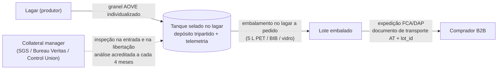
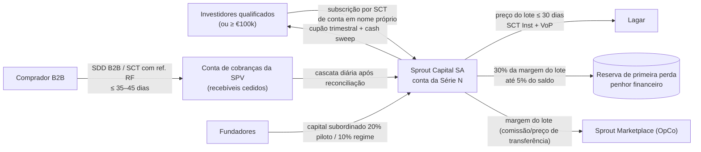
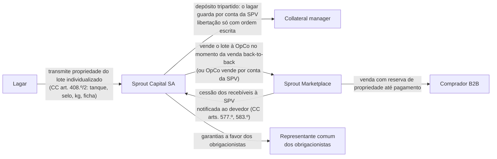
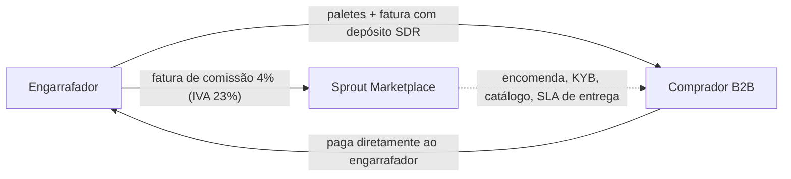

# 01 — Desenho do modelo de negócio (recomendação)

> **Data:** 13-10-2026. **Para:** fundadores do Sprout (Gonçalo Almeida, Pedro Marques, Speaker 1, Speaker 2) e quem escrever o business plan, o resumo em PDF e a webapp.
> **Base numérica:** `00-base-factual.md` (factos e fontes) e `docs/business-plan/modelo/pressupostos.json` (pressupostos). Todos os números deste documento saem desses dois ficheiros; os cálculos foram feitos com os mesmos parâmetros do JSON.
> **Etiquetas:** [F] facto com fonte; [L] referência legal/técnica não relida online; [E] estimativa nossa; [I] inferência/opinião nossa; NV não verificado.
> **Tom:** isto é a opinião de um conselheiro, não um parecer jurídico. Onde a tese do documento-fonte não fecha, dizemo-lo e propomos o que muda.

---

## Sumário para os fundadores

1. **A tese só fecha numa leitura.** "80–90% da margem do embalador" não pode ser o que o Sprout guarda: essa margem vale 0,19–0,50 €/kg [F] e um desconto de 10% sobre ~6 €/kg custa 0,60 €/kg. A leitura coerente é: **do bolo dos intermediários (embalador + distribuidor), 80–90% é redistribuído entre comprador (desconto), Sprout (margem) e investidores (cupão); 10–20% é consumido por custódia, qualidade, pagamentos e crédito.** No lote-tipo, esse número dá **88%**.
2. **O desconto de 10% cabe; o de 15% quase não.** Num lote de 20 t de AOVE de origem identificada, vendido contra uma referência de 6,00 €/kg, a margem de contribuição do Sprout é de **12,2% (0,66 €/kg)** com 10% de desconto e **7,1%** com 15%. Contra azeite *standard* (referência 5,40 €/kg), 15% de desconto dá margem negativa. Contra marca branca espanhola, nunca fecha.
3. **"Liquidação a 18 meses" é o vencimento legal das obrigações, não o tempo de detenção do azeite.** O lote roda em 2–4 meses; o produtor recebe em ≤ 30 dias; o comprador paga em ≤ 35 dias; o investidor tem vencimento esperado a 12 meses e final a 18. Segurar azeite 18 meses custa ~20% em carry e arrisca 37–57% em preço [E].
4. **Estrutura da fase 1:** Sprout Marketplace (OpCo PT, **principal** no azeite, **agente com faturação direta** na água) + Sprout Capital, SA (SPV PT que emite obrigações **só a investidores qualificados ou com subscrição ≥ €100.000**). Sem retalho, sem "jogadores", sem gamificação, sem "reembolso garantido".
5. **Piloto (01-02 a 31-07-2027):** 3 lagares + 2 engarrafadores, ~36 compradores, 3–6 investidores, 40 t de azeite + 120 paletes de água, ~€240k de GMV, série de **€150k** (€120k sénior + €30k subordinado dos fundadores). Gate a 31-08-2027.
6. **Economia a 5 anos (base):** 2.200 t de azeite e €12,3M de GMV em 2031, margem de contribuição de ~10,6%, EBITDA ≈ 0 em 2031. **Necessidade de capital próprio ≈ €2,9M.** No otimista, EBITDA positivo em 2030 e necessidade de €1,7M. No pessimista, nunca chega ao *break-even*: **parar no gate**.
7. **Os maiores riscos não são de mercado:** promoção a retalho, *backoffice* "reverse engineered", conflito de interesses com o lagar âncora e um parecer jurídico que não é independente.

---

## 1. Interpretação da tese

### 1.1 O que o documento-fonte afirma

| Afirmação | Texto do documento-fonte | Problema |
|---|---|---|
| Captura de margem | "80–90% — Margem do embalador capturada" | A margem líquida do embalador é 0,19–0,50 €/kg (4,9–14,1% do PVP s/ IVA) [F]; os embaladores operam com EBITDA de 5–6% [F] |
| Desconto | "10–15% — Desconto ao cliente vs. mercado" | "Mercado" não está definido. Contra marca branca espanhola (3,99–4,57 €/kg s/ IVA) [F] o desconto é impossível |
| Liquidação | "Ciclo de 18 meses — janelas previsíveis de liquidação com extensão e *refunding*" | Pagar ao produtor a 18 meses é proibido (≤ 30/60 dias, Dir. 2019/633) [F]; segurar azeite 18 meses é especulação [E] |
| Hedging | "Spread operacional retido com hedging"; "hedge funds/taxas de cobertura" | Não há futuros de azeite desde o fecho do MFAO (2016–17) [F] |
| Investidores | "HNWIs", "investidores não sofisticados (jogadores)" | Retalho com retorno prometido = reserva bancária, MiFID, PRIIPs, precedentes Afinsa/Asset Land [F] |

### 1.2 Leitura coerente: um único fluxo de mercadoria e de dinheiro

**Definições que propomos adotar em todos os documentos:**

- **Bolo de intermediação (Π)** = preço de referência que o comprador paga hoje pelo produto equivalente − preço do granel ao lagar − custo físico de embalamento − custo físico de logística. É o que hoje fica com embalador, distribuidor e retalhista (margens e despesas gerais).
- **Taxa de redistribuição** = (desconto ao comprador + margem do Sprout + cupão do investidor) ÷ Π. **É esta a métrica "80–90%"**: mede quanto do bolo dos intermediários deixa de lhes pertencer. O resto (10–20%) é o custo de fazer o trabalho deles com controlo: custódia, análises, armazenagem, pagamentos, KYC, crédito.
- **Desconto** = diferença, em €/kg, entre a referência **observada e documentada** (cotação de cash & carry, *foodservice* ou lista do concorrente para o produto equivalente) e o preço Sprout. Meta: **10%** a HoReCa e lojas *gourmet*; **5%** a distribuidores e exportadores.
- **Ciclo de 18 meses** = vencimento legal das obrigações da Sprout Capital. Vencimento esperado em **M12** (uma campanha); **uma** extensão condicionada até **M18**. O ciclo físico de cada lote é de **2–4 meses**.
- **"Refunding"** = palavra só de uso interno, no sentido técnico de **refinanciamento** de uma série por outra. Em materiais externos: "mecanismos de liquidez e extensão".

### 1.3 Os três lados e a plataforma

| Lado | Quem | O que dá | O que recebe | Contrato |
|---|---|---|---|---|
| **Produtores** | Lagares do Alentejo e Trás-os-Montes (âncora: Lagar do Val + 2); engarrafadores com captação reconhecida pela DGEG; na fase 2, importadores de café verde da UE | Lote individualizado, ficha analítica, embalamento no lagar, telemetria do tanque | Preço = índice (média 2 semanas SIMA + Poolred) + prémio de origem; **pagamento ≤ 30 dias por SCT Inst** | Produtor↔Sprout: compra, depósito tripartido, força maior com lista fechada |
| **Compradores B2B** | HoReCa média/alta, lojas *gourmet*, distribuidores *foodservice*, exportadores | Encomenda firme ou *offtake*; mandato SDD B2B | Azeite de origem rastreável com ~10% de desconto sobre a referência documentada; entrega e crédito a 30–45 dias | Condições gerais de venda; *offtake* acima de 10 t |
| **Financiadores** | Fase 1: investidores qualificados ou com ≥ €100k; fase 2: banco parceiro (financiamento de stock de terceiros) | Capital para stock e recebíveis | **Cupão fixo de 8%/ano** (base 2027), garantido por penhor/propriedade dos lotes e cessão de recebíveis; sem participação no preço do azeite | Termos e condições das obrigações; representante comum |
| **Plataforma** | **Sprout Marketplace** (OpCo), **Sprout Capital, SA** (SPV), *collateral manager* independente | Curadoria, verificação, custódia, logística, crédito, *ledger* e reconciliação diária | Margem de principal; comissão de agente na água; comissões de verificação (fase 2) | — |

### 1.4 Fluxos

**Mercadoria (azeite, modelo principal)**

**Dinheiro**

**Título e colateral**

**Água (modelo agente com faturação direta)**

Sem fundos de terceiros na Sprout, sem stock, sem depósitos SDR no balanço e sem necessidade de PSP *marketplace* [I].

### 1.5 Calendário de um lote (HoReCa, base)

| Dia | Evento | Dinheiro | Título |
|---|---|---|---|
| D−30 | Encomendas e *offtake* cobrem ≥ 85% do lote; análise de pré-compra | — | Lagar |
| D0 | Tanque selado, inspeção de entrada, ficha do lote; utilização da série | Compromisso de pagamento ao lagar | **SPV** |
| D0–D90 | Embalamento a pedido; expedições; faturas com ref. RF | — | SPV → OpCo → comprador em cada expedição |
| D30 | Pagamento ao lagar | SCT Inst (SPV → lagar) | — |
| D35–D125 | Cobranças SDD B2B | Comprador → conta de cobranças → cascata diária | — |
| D125 | Lote fechado; capital reutilizado no lote seguinte ou amortizado (*cash sweep*) | — | — |
| M12 / M18 | Reembolso esperado da série / vencimento legal | SPV → investidores | — |

---

## 2. Aritmética com números reais

### 2.1 Pressupostos do lote-tipo (base, fev. 2027)

| Parâmetro | Valor | Origem |
|---|---|---|
| Preço do granel ao lagar | 3,60 €/kg = índice 3,50 + prémio 0,10 | SIMA PT 3,40–3,80 e 3,50 (sem. 39/2026); Poolred 3,34 [F] — `00-base-factual.md` §1.2 |
| Embalamento no lagar | 0,55 €/kg | Observatorio 0,47–0,51 €/kg [F] + mix com vidro [E] |
| Logística até HoReCa | 0,30 €/kg | 0,15–0,30 €/kg [E] |
| Armazenagem / seguro / análises | 4 €/t/mês; 0,2%/ano; 2 × €300 por lote | [E] `40-risco-coberturas.md` §5.2 |
| Perdas / desclassificação esperada | 0,5% uma vez; 3% por trimestre × 0,30 €/kg | [E] idem |
| Custódia (*collateral manager*) | €1.200 por lote | [E] €300–1.500 por inspeção |
| Pagamentos, KYC, faturação | 0,02 €/kg | [E] rails SEPA bancários |
| Provisão de crédito | 0,6% das vendas | [E] com SDD B2B |
| Financiamento | cupão 8%/ano; ciclo líquido 95 dias (90 stock + 35 recebimento − 30 pagamento); utilização 80% | [E] |
| **Preço de referência do comprador** | **6,00 €/kg s/ IVA** (≈ 5,50 €/L) | **[E] NV**: retalho PT 6,67 €/kg com granel a 4,43 (abr. 2026) ajustado à descida do granel; porta do lagar 6,08 €/L (mar. 2026) [F] |
| Desconto | 10% | Documento-fonte (limite inferior) |

### 2.2 Lote de 20 t de AOVE (HoReCa/gourmet)

| Linha | € (20 t) | €/kg |
|---|---|---|
| Valor à referência (6,00 €/kg) | 120.000 | 6,000 |
| Desconto ao comprador (10%) | −12.000 | −0,600 |
| **Receita Sprout** | **108.000** | **5,400** |
| Compra do granel ao lagar | 72.000 | 3,600 |
| Embalamento | 11.000 | 0,550 |
| Logística | 6.000 | 0,300 |
| Armazenagem (3 meses) | 240 | 0,012 |
| Seguro do stock | 36 | 0,002 |
| Análises (entrada + intermédia) | 600 | 0,030 |
| Perdas físicas | 360 | 0,018 |
| Desclassificação esperada | 180 | 0,009 |
| Custódia e inspeção | 1.200 | 0,060 |
| Pagamentos, KYC, faturação | 400 | 0,020 |
| Provisão de crédito | 648 | 0,032 |
| Cupão do investidor (capital parado incluído) | 2.160 | 0,108 |
| Custo de cobertura explícito | 0 | 0 |
| **Total de custos diretos** | **94.824** | **4,741** |
| **Margem de contribuição do Sprout** | **13.176** | **0,659 (12,2%)** |
| Retida na reserva de primeira perda (30% da margem, teto 5% do saldo) | 3.735 | 0,187 |
| Margem livre para a OpCo após reserva | 9.441 | 0,472 |

**Do lado do investidor (regime, 90% de *notes*):** €74.700 de obrigações financiam o lote; o cupão do ciclo (95 dias) é de €1.555; o retorno é **8,0%/ano bruto**, ou ~5,8% líquido para um particular residente (retenção de 28% [L]). O investidor não ganha nem perde com o preço do azeite enquanto a almofada (subordinado + reserva) absorver as perdas.

### 2.3 Repartição do bolo de intermediação

Π = 120.000 − 72.000 − 11.000 − 6.000 = **€31.000 (1,55 €/kg)**.

| Destino | € | % de Π |
|---|---|---|
| Comprador (desconto) | 12.000 | 38,7% |
| Sprout (margem de contribuição) | 13.176 | 42,5% |
| Investidores (cupão) | 2.160 | 7,0% |
| **Redistribuído (a métrica "80–90%")** | **27.336** | **88,2%** |
| Atrito: custódia, análises, armazenagem, perdas, crédito, pagamentos | 3.664 | 11,8% |

### 2.4 A leitura literal falha

Margem líquida do embalador × 20 t = €3.800 (0,19 €/kg) a €10.000 (0,50 €/kg) [F]. Capturar 80–90% dá **€3.040–9.000**. Só o desconto de 10% custa **€12.000** (15%: €18.000). **Com a definição literal, o desconto custa 1,3 a 5,9 vezes o que se captura.** O deck não pode usar "80–90% da margem do embalador" sem esta correção: seria uma afirmação enganosa perante investidores (MiFID art. 24.º(3) [L]).

### 2.5 Sensibilidade (mesmo lote de 20 t)

| Referência do comprador | Desconto | Receita | Margem Sprout | % | €/kg | Redistribuído | Sprout / Π |
|---|---|---|---|---|---|---|---|
| Origem identificada, 6,00 €/kg | 10% | 108.000 | **13.176** | **12,2%** | 0,66 | 88% | 43% |
| Origem identificada, 6,00 €/kg | 15% | 102.000 | 7.212 | 7,1% | 0,36 | 88% | 23% |
| AOVE *standard*, 5,40 €/kg (granel 3,50, sem prémio) | 10% | 97.200 | 4.504 | 4,6% | 0,23 | 83% | 21% |
| AOVE *standard*, 5,40 €/kg | 15% | 91.800 | **−864** | −0,9% | −0,04 | 83% | −4% |
| Marca branca ES 1 L, 4,57 €/kg | 10% | 82.260 | **−10.346** | −12,6% | −0,52 | — | — |
| Retalho PT médio abr. 2026, 6,67 €/kg | 10% | 120.060 | 25.164 | 21,0% | 1,26 | 92% | 57% |
| Retalho PT médio abr. 2026, 6,67 €/kg | 15% | 113.390 | 18.534 | 16,3% | 0,93 | 92% | 42% |

**Desconto máximo compatível com cada margem-alvo:**

| Margem-alvo do Sprout | Referência 6,00 (origem) | Referência 5,40 (*standard*) |
|---|---|---|
| 0% (*break-even* do lote) | 21,0% | 14,2% |
| 5% | 16,9% | 9,7% |
| 10% (necessária para cobrir estrutura à escala do plano) | **12,2%** | **4,6%** |

A última linha da referência 6,67 €/kg (retalho de abril) **não é uma referência HoReCa**: o granel caiu ~20% desde então e a HoReCa compra abaixo do retalho. Não a usar no deck [I].

### 2.6 E se o lote ficar 18 meses?

Carry a 18 meses ≈ **19,8%** do valor; VaR 95% de preço a 18 meses **37–57%** [E]. Contra uma margem de 12%, a perda potencial é de **45–65% do lote**. Com azeite não há futuros para cobrir isto. **Detenção longa não é financiável sem passar o risco de preço para o investidor**, e isso transforma o produto em derivado ou FIA (`20-regulatorio.md` §2).

### 2.7 Lote de água (20 paletes = 15.000 L = 10.000 garrafas de 1,5 L)

| Linha | Principal, 10% | Principal, 15% | Agente (recomendado) |
|---|---|---|---|
| Valor à referência (0,40 €/L, **NV**) | 6.000 | 6.000 | 6.000 |
| Receita / GMV | 5.400 | 5.100 | GMV 5.400 |
| Preço ex-fábrica (0,24 €/L, média DGEG [I]) | 3.600 | 3.600 | — |
| Logística (troncal ~€200 + entrega 0,05 €/L) | 950 | 950 | — (engarrafador) |
| Operação, pagamentos | 150 | 150 | — |
| Financiamento (stock + depósitos, 30 dias) | 38 | 38 | — |
| Provisão de crédito | 32 | 31 | — |
| **Margem / comissão Sprout** | **630 (11,7%; 0,042 €/L)** | **332 (6,5%)** | **216 (4% do GMV)** |
| Depósito SDR a adiantar e reconciliar | 1.000 (19% da receita) | 1.000 | 0 |
| Margem de embalador capturável | **0** (embalamento na origem obrigatório [F]) | 0 | 0 |

**Leitura:** a percentagem parece aceitável como principal, mas o valor absoluto é irrelevante (€630 por 20 paletes; seriam precisas ~9.300 paletes/ano para pagar 1,5 FTE), assume que um engarrafador vende a um comprador pequeno ao preço médio do mercado (improvável) e obriga a gerir depósitos SDR. **Não há margem de embalador a capturar e não há nada para financiar** (€3.600 de stock durante 30 dias). A água fica como **agente com faturação direta**, sem investidores, e com critério de saída no gate.

### 2.8 Veredicto: o que cabe e o que tem de ceder

**Cabem em simultâneo** "80–90%", "10% de desconto", "8% ao investidor" e uma margem de plataforma de ~12% **apenas** quando se verificam as cinco condições:
1. azeite de **origem identificada** (lagar, lote, ficha analítica; DOP/monovarietal quando houver);
2. vendido a compradores que hoje pagam **≥ 6,00 €/kg s/ IVA** pelo equivalente (referência documentada);
3. desconto de **10%**, não 15%;
4. lote rodado em **≤ 3–4 meses**, ≥ 85% vendido *back-to-back*;
5. produtor pago a preço de índice + prémio pequeno, e não acima do mercado.

**Tem de ceder:**

| O quê | Como fica |
|---|---|
| "80–90% da margem do embalador" | "80–90% do bolo de intermediação redistribuído; o Sprout retém ~40%" |
| "10–15% de desconto" | "Até 10% sobre uma referência documentada em €/kg; 5% a compradores profissionais; nunca contra marca branca" |
| "Liquidação a 18 meses" | "Vencimento esperado a 12 meses, legal a 18, com uma extensão condicionada" |
| "Refunding" | Reserva de primeira perda + extensão + *cash sweep* + refinanciamento voluntário |
| Água como "captura de margem" | Água como serviço de agente (4%), sem tese de margem |
| AOVE *standard* para HoReCa | Fora: é o produto-chamariz do cash & carry |

---

## 3. Estrutura jurídica e regulatória

### 3.1 Matriz de opções

| Opção | Licença | Público | Limite | Custo inicial [E] | Prazo [E] | Risco regulatório | Encaixe na tese | Decisão |
|---|---|---|---|---|---|---|---|---|
| **A.** Marketplace agente com PSP *marketplace* | Do PSP | Empresas | — | €5–20k + PSP (Lemonway €5.490 + €840/mês) | 1–3 meses | Baixo | Baixo (comissão < 1–3%) | Só na água, e **sem PSP** (faturação direta) |
| **B.** OpCo principal (compra e revende) | Nenhuma | Empresas | Balanço | Baixo | 1–3 meses | Baixo | **Alto** | **Sim — azeite** |
| **C.** SPV PT (SA) emite obrigações a qualificados / ≥ €100k | Nenhuma em colocação direta pelo emitente | Qualificados; ≥ €100k por investidor | Isenções do art. 1.º(4) | €15–40k + ~€25k/ano | 2–3 meses | Médio (parecer sobre FIA e RGICSF) | **Alto** | **Sim — a partir de abr. 2027** |
| **D.** Promotor em plataforma ECSP de terceiros | Do parceiro (CMVM) | Incl. não sofisticados | **€5M/12 meses** | Comissões NV + €10–20k | 3–6 meses | Médio | Médio (capital de retalho custa 10–13%/ano) | Fase 2+, só recebíveis ou lotes diferenciados |
| **E.** FIA + AIFM | AIFM | Profissionais | Limiares AIFMD | €100–250k + €80–200k/ano | 3–9 meses | Baixo, mas pesado | Médio | Não (só acima de €10–20M) |
| **F.** Licenças próprias (IP/IME/ECSP) | Sprout | Conforme licença | — | €150–500k + equipa | 9–18 meses | Baixo, mas lento | Baixo | Não |
| **G.** Venda direta a "jogadores" com retorno | — | — | — | — | — | **Crime** (RGICSF art. 200.º) | — | **Proibido** |
| **H.** Veículo ou *token* fora da UE | Local | Na UE, os mesmos limites | MiCA/MiFID | Baixo à entrada | Anos para banca UE | Alto | — | **Não** |
| **I.** Banco parceiro como mutuante; Sprout origina e verifica | Do banco | Lagares (crédito) | Apetite do banco | Jurídico €10–20k | 4–9 meses | Baixo | **Alto (fosso)** | **Fase 2 (2028)** |

### 3.2 Decisão para a fase 1

| Entidade | Forma | Papel | Notas |
|---|---|---|---|
| **Sprout Marketplace** (OpCo) | Lda ou SA (SA se houver rondas de capital) | Principal no azeite; agente na água; *servicer* da SPV; emite faturas por software certificado AT | Contas bancárias: operação + reserva de IVA |
| **Sprout Capital, SA** (SPV) | SA, detida pela OpCo, com 1 administrador independente | Compra e detém os lotes individualizados; emite obrigações por série; recebe as cobranças (recebíveis cedidos) | Uma conta bancária por série; representante comum dos obrigacionistas (CSC art. 357.º ss. [L]); cláusulas de *limited recourse* e *non-petition*; ROC |
| *Collateral manager* | Contrato com inspetora independente | Detém por conta da SPV; certifica existências; inspeção na entrada e libertação | Nunca o lagar âncora sozinho |

**Porque não FIA [I, a confirmar no parecer]:** a SPV tem finalidade comercial (compra e vende mercadoria a clientes reais com risco comercial), paga **cupão fixo** e não um retorno agregado indexado ao desempenho dos lotes, e não tem política de investimento discricionária. **Porque não captação ilícita de fundos reembolsáveis:** emite obrigações nos termos do CSC (exceção do RGICSF art. 9.º [L]). **Porque não derivado:** o investidor não recebe diferenças de preço do azeite; recebe juro.

**Atenção ao Regulamento de Titularização (UE) 2017/2402** [L]: subordinar o patrocinador sobre uma carteira que inclui recebíveis pode configurar *tranching*. O parecer tem de o afastar (por exemplo, estruturando o subordinado como capital ou suprimentos da OpCo e não como *tranche*).

### 3.3 Públicos permitidos no piloto

| Público | Permitido? | Condição |
|---|---|---|
| Compradores | Sim | Só empresas e ENI com NIF e atividade; KYB; SDD B2B |
| Produtores | Sim | Lagares licenciados; engarrafadores com captação reconhecida; KYB; IBAN validado por VoP |
| Investidores profissionais *per se* (MiFID II, Anexo II, I) | Sim | Documentar a categoria |
| Profissionais a pedido | Sim | Pedido escrito + **2 de 3** critérios (carteira > €500k; 10 transações/trimestre; ≥ 1 ano no setor financeiro), com evidência guardada |
| Qualquer investidor com subscrição ≥ €100.000 | Sim | Art. 1.º(4)(d) Reg. Prospetos; KYC e origem de fundos |
| "HNWI" sem estes critérios | **Não** | "Rico" não é "qualificado" |
| **Retalho / "jogadores"** | **Não** | Ver abaixo |
| Investidores fora de PT | Não no piloto | *Reverse solicitation* não serve; exige análise local |
| Residentes ou fundos de países da lista UE de alto risco | Não | Lista atualizada a 29-01-2026 [F] |

**Porque os "jogadores" ficam fora — sete razões:**
1. **Reserva bancária:** "entregue €X; devolvemos €X + 10–15%; se correr mal fazemos *refunding*" é captação de fundos reembolsáveis; fora das obrigações, é crime (RGICSF art. 200.º) [F/L].
2. **Precedentes:** Afinsa/Fórum Filatélico (ativo tangível + recompra prometida; penas até 12 anos), Asset Land e Capital Alternatives (lotes individuais e colheitas = OIC), Cimovelpark (alerta CMVM) [F].
3. **Retalho exige** plataforma ECSP (teto €5M/ano, teste, simulação de perdas, 4 dias de reflexão, KIIS), intermediário autorizado ou prospeto, e KID PRIIPs [F].
4. **Gamificação** é alvo declarado da ESMA (DP ESMA35-43-3682) e da IOSCO; a diretriz aprovada no documento-fonte já a proíbe [F].
5. **Custo de capital:** o capital de retalho via ECSP custa 10–13%/ano [E], o que consome a margem inteira de um lote *standard*.
6. **Rails:** os PSP proíbem ou restringem investimento e *crowdfunding* nas AUP; descobrir o fluxo *a posteriori* = conta congelada ("dinheiro preso") [F].
7. **Reputação:** um único alerta CMVM fecha bancos e investidores qualificados para o resto do projeto.

**Para o futuro (fase 2+), duas vias limpas:** (a) promotor numa ECSP de terceiros (Raize tem autorização ECSP [F]; Goparity e Miimosa a verificar), só para recebíveis curtos ou lotes diferenciados; (b) "adoção" ou pré-compra de colheita **com entrega em espécie e sem *cash-out***, ao estilo CrowdFarming, para consumidores e pequenos clientes (confirmar regime de recompensa da Lei 102/2015).

### 3.4 Jurisdição

- **Fase 1: Portugal** para OpCo e SPV. Rails bancários UE sem risco de repatriação; custo de €15–40k e 1–2 meses [E].
- **Escala (> €5–10M de obrigações e investidores internacionais):** veículo de titularização luxemburguês por compartimentos; sem autorização CSSF enquanto não houver emissões contínuas ao público [F].
- **Rejeitar** estruturas fora da UE e *tokens*: BVI na lista UE de alto risco desde 29-01-2026; MiCA/MiFID aplicam-se onde está o investidor; banca UE com diligência reforçada [F].

### 3.5 Perguntas para o parecer jurídico (antes do primeiro euro de investidor)

O parecer tem de ser **escrito, assinado por advogado independente** (não por um sócio do projeto) e sobre o *term sheet* final:
1. A SPV é FIA à luz das orientações ESMA/2013/611?
2. A emissão cabe na exceção do RGICSF art. 9.º (obrigações nos termos do CSC)? Que limites do CSC se aplicam a uma SA recém-constituída?
3. Isenção de prospeto aplicável (art. 1.º(4)(a) e (d)) e se a CMVM exige documento informativo abaixo de €12M.
4. Quem pode comercializar as obrigações: só a administração da SPV? A OpCo pode apresentar o produto sem licença MiFID?
5. Venda SPV→OpCo vs. comissão (Código Comercial art. 266.º [L]): efeitos em IVA, faturação e insolvência.
6. Transmissão de propriedade e penhor de coisa genérica depositada no lagar; armazéns gerais e *warrant*; contrato de depósito tripartido.
7. Regulamento de Titularização: o subordinado do patrocinador cria *tranching*?
8. Financiar stock de terceiros (fase 2): reserva de concessão de crédito; estrutura com banco mutuante.
9. Retenção na fonte sobre juros e regime fiscal da SPV.

### 3.6 PSP/IME e bancos (lista curta)

| Função | Fase 1 (recomendado) | Alternativa / fase 2 | Excluir |
|---|---|---|---|
| Contas da OpCo (cobrança e pagamento) | Banco PT com SCT Inst + VoP, ID de credor SDD B2B e extratos camt.053 (pedir a 2–3 bancos; disponibilidade de camt.053 **NV**) | — | — |
| Contas da SPV (uma por série) | Banco PT diferente do da OpCo, com o parecer e o fluxograma AML na primeira reunião | Banco luxemburguês na escala | Carteiras de PSP para dinheiro de investidores |
| Pagamentos pequenos/conveniência | ifthenpay (MB WAY 0,7% + €0,07) ou easypay (1,5% + €0,25) | — | Como *rail* principal (1,5–1,8% destrói a margem) |
| PSP *marketplace* (só se houver fundos de terceiros) | — | **Lemonway** (IP ACPR, preçário público, experiência em plataformas de investimento) → **Mangopay** (IME CSSF) | **Stripe** para qualquer fluxo de investidor; **Treezor** (sanção AML 2024 e mudança de controlo em out. 2026); Swan (mínimo ~€2.990/mês) |

### 3.7 KYC/KYB/AML (lista curta)

| Necessidade | Escolha | Notas |
|---|---|---|
| Identidade + KYB + *screening* | **Sumsub** ou **Veriff** (KYC) + **ComplyAdvantage** (sanções, PEP, *adverse media*) | Preços [L/NV]: ~US$0,80–1,89 por verificação; pedir RFP com cobertura do registo comercial PT, dados na UE e mínimo mensal |
| Portugueses | Chave Móvel Digital / Cartão de Cidadão via Autenticação.gov; assinatura qualificada | Condições de adesão **NV** |
| Empresas PT | Código da certidão permanente + RCBE + VoP | Revisão anual |
| QES para contratos de investidores | IDnow (se necessário) | — |
| Custo no piloto | €300–1.200/mês no arranque [E] | ~70 KYB + ~100 identidades |

---

## 4. Arquitetura de risco

### 4.1 Política de cobertura por mercadoria

| Mercadoria | Instrumentos permitidos | Proibidos | Limites | Custo |
|---|---|---|---|---|
| **Azeite** | Venda *back-to-back* (preço fixo ou indexado); compra indexada (média 2 semanas SIMA + Poolred) ± prémio; compra a prazo com lagar **só** com venda casada; fixação diferida simultânea; preço mínimo/máximo embutido em contrato físico | Derivados liquidados em dinheiro (incl. opções OTC); cobertura cruzada com outros óleos; vendas a prazo sem físico; detenção especulativa | Aberta ≤ **15%** do *book* no piloto; em regime ≤ min(25%; almofada ÷ 0,30); curta = **0**; idade ≤ 6 meses à entrada e ≤ 15 meses no balanço; produtor ≤ 50% (piloto) / ≤ 35% (2028+); comprador ≤ 20% dos recebíveis | Explícito 0; implícito no desconto e na reserva |
| **Café** (2029; otimista 2028) | Compra em EUR a preço fixo a importador UE operador EUDR; PTBF com fixação simultânea; *forward* EUR/USD entregável | ICE abaixo de 50–100 t/ano | USD em aberto ≤ 10% das compras dos 3 meses seguintes; ICE só com Comité e linha de liquidez ≥ 30% do nocional | *Forward* 0,1–0,5% [E/NV] |
| **Água** | Contratual: preço anual indexado com teto ±5–8%; sobretaxa de combustível; capacidade de verão | Qualquer derivado | Modelo agente: o risco de preço fica no engarrafador | 0 |
| **Crédito** | SDD B2B obrigatório para HoReCa recorrente; pré-pagamento nas 3 primeiras encomendas; limite por cliente; seguro de crédito a partir de 2028 | Vendas a crédito sem mandato | DSO ≤ 35 dias; alerta a 40; suspensão a 45 | Provisão 0,6% (HoReCa) / 0,3% (distribuidores) |
| **Custo total de cobertura** | — | — | ≤ 30% da margem bruta esperada; acima disso, reduzir exposição | — |

### 4.2 Almofada de primeira perda

- **Capital subordinado dos fundadores:** **20%** da série piloto (€30k de €150k); **10%** em regime.
- **Reserva de primeira perda:** 30% da margem de contribuição de cada lote, até **5%** do saldo vivo das obrigações; conta segregada com penhor financeiro a favor do representante comum; não distribuível enquanto houver obrigações vivas.
- **Cascata de perdas:** margem do lote → reserva → subordinado → extensão com *cash sweep* → obrigacionistas sénior.

### 4.3 Extensão e refinanciamento (o "refunding" redefinido)

| Mecanismo | Regra |
|---|---|
| **Extensão** (opção do emitente) | Uma só, máximo 6 meses (M12 → M18); aviso até M12−30 dias; gatilho objetivo: índice ≤ −20% face ao preço médio de entrada **ou** procura contratada < 50% do stock a M12−60 dias; teste de racionalidade económica validado pelo membro independente; lotes aptos (qualidade, idade < 15 meses no fim) |
| Compensação na extensão | *Step-up* de **+250 p.b.**; *cash sweep* de 100%; suspensão de distribuições ao patrocinador; relatório mensal por lote |
| **Amortização antecipada** (*cash sweep*) | Mensal: caixa livre acima de 10% do saldo → reembolso *pro rata* ao par |
| **Refinanciamento** | Oferta voluntária de troca para a série seguinte; o reembolso da série antiga **nunca** depende da subscrição da nova |
| **Proibido** | "Reembolso garantido", "capital protegido", recompra prometida, liquidação em espécie a investidores |

### 4.4 Stress tests

**Série piloto** (*book* de €150k ao custo ≈ 36 t; 85% vendido *back-to-back*; recebíveis €60k):

| Cenário | Perda | Almofada 15% (€22,5k) | **Almofada 20% (€30k)** |
|---|---|---|---|
| S1 — índice −30% (15% em aberto; 20% dos compradores renegoceiam) | €14,4k | Absorvida | Absorvida |
| S2 — quebra de colheita (+60%) | Neutro: os lotes do piloto são stock já em tanque; o aberto ganha ~€13,5k | Sem perda | Sem perda |
| S2b — venda a prazo sem físico, preço +60% | **€90k (60% do *book*)** | Destrói a série | Destrói a série → **proibido** |
| S3 — 10% dos recebíveis em incumprimento, 50% de recuperação | €3,0k | Absorvida | Absorvida |
| S4 — 25% do stock desclassificado a 0,45 €/kg | €4,1k | Absorvida | Absorvida |
| **S5 — S1 + S3 + S4 + atraso de 3 meses nas vendas (carry €5,4k)** | **€26,9k** | **Perda sénior €4,4k (3,4%)** | **Sénior intacto; sobram €3,1k** |

Daí os 20% de subordinado no piloto, enquanto a reserva está vazia.

**Book de regime** (€500k, 147 t, almofada 15%; `40-risco-coberturas.md` §5.4): S1 com a política −€60k (absorvido); S5 −€100k, excede a almofada em ~€25k (5,6% do sénior) → ativa extensão com *cash sweep*.

**Detenção de 18 meses:** perda potencial de 45–65% do lote (secção 2.6). Não há almofada que a absorva.

### 4.5 Gatilhos (da política de cobertura)

| Gatilho | Nível | Ação | Prazo |
|---|---|---|---|
| Índice −10% face à entrada do aberto | Amarelo | Congelar compras abertas | 24 h |
| Índice −20% | Laranja | Contratar ≥ 50% do aberto; recalcular *borrowing base* | 5 dias úteis |
| Índice −30% ou almofada < 50% | Vermelho | Aberto a zero; avaliar extensão; informar o representante comum | 10 dias úteis |
| K232 ≥ 2,30, peróxidos ≥ 15 ou frutado < 2,0 | Qualidade | Vender em ≤ 30 dias ou reclassificar | 30 dias |
| DSO de um comprador > 45 dias | Crédito | Suspender entregas | Imediato |
| Variação de nível do tanque sem ordem, ou > 25 °C durante 48 h | Operacional | Inspeção pelo *collateral manager* | 48 h |

### 4.6 Governação mínima

- **Responsável de Risco e Tesouraria nomeado antes da 1.ª emissão** (o documento-fonte tem "owner a designar"). Perfil: *trade finance* ou tesouraria de *trading*. Sem esta pessoa, não há emissão.
- **Comité de Risco** mensal com um **membro independente com veto** em matérias da SPV.
- **Quatro olhos** em: alteração de IBAN de produtor; pagamentos acima de €25k; libertação de lote financiado; contratos de venda a prazo; alteração de regras de reconciliação.
- **Partes relacionadas:** nenhuma pessoa com interesse no Lagar do Val aprova preço, qualidade ou libertação de lotes do Lagar do Val (ver alerta 7).

---

## 5. Desenho do piloto

### 5.1 Calendário

| Fase | Datas | Entregáveis |
|---|---|---|
| **Fase 0 — preparação** | 13-10-2026 → 31-01-2027 | Constituição da OpCo e da SPV; parecer jurídico; auditoria do *backoffice* e *pentest*; *ledger* limpo; contas bancárias; contratos (produtor, depósito tripartido, comprador, obrigações); 20–30 cotações de referência; política de cobertura aprovada; telemetria em 3 locais; seguro do stock |
| **Piloto fechado** | 01-02-2027 → 31-07-2027 | Lotes comprados de stock da campanha 2026/27 (fev.–abr.); 1.ª série em **abr. 2027** (até lá, stock financiado por capital próprio); reconciliação diária desde o dia 1 |
| **Gate** | 31-08-2027 | Decisão go/no-go com os critérios de 5.4 |
| **Fase 2** | a partir de 01-09-2027 | Campanha 2027/28 (compras nov.–fev.); 2.ª série; RFP de banco parceiro (financiamento de terceiros) |

### 5.2 Coorte e dimensões

| Dimensão | Valor | Racional |
|---|---|---|
| Produtores | **3 lagares** (Lagar do Val + 2 contratados antes da 1.ª emissão) + **2 engarrafadores** | Concentração ≤ 50% no âncora |
| Compradores | **~36**: 25 HoReCa média/alta, 8 lojas *gourmet*/retalho independente, 3 distribuidores ou exportadores com *offtake* | HoReCa: 150–300 L/ano por cliente [E] |
| Investidores | **3–6**, ticket mínimo €25k (profissionais) ou €100k (restantes) | Série de €150k: €120k sénior + €30k subordinado |
| Volume | **40 t de azeite** (2 lotes de 20 t) + **120 paletes de água** | Capital médio empregue ≈ €90–120k |
| GMV alvo | **~€240k** em 6 meses (azeite ~€206k; água ~€32k) | 60/40 HoReCa/distribuidores |
| Ticket médio por encomenda HoReCa | €400–900 | [E] |
| Duração | 6 meses + 1 mês de avaliação | Cobre uma rotação completa de 2 lotes |

### 5.3 KPIs e metas

| KPI | Definição | Meta | Frequência |
|---|---|---|---|
| ***Fill rate*** | Linhas entregues completas e no prazo ÷ linhas aceites | **≥ 95%** (≥ 97% no mês 6) | Diária |
| **Variação de base (compra)** | Preço pago ao lagar − (índice SIMA+Poolred 2 semanas + prémio contratado) | **≤ 0,05 €/kg** em média; nunca > 0,15 €/kg | Por lote |
| **Variação de base (venda)** | Desconto realizado vs. referência documentada | **8–12%** em ≥ 90% das encomendas | Semanal |
| Margem de contribuição azeite | Após todos os custos diretos e cupão | **≥ 8%** do GMV e ≥ 0,40 €/kg | Por lote |
| **SLA de pagamento ao produtor** | Dias entre fatura/entrega e SCT Inst | **≤ 30 dias em 100%**; 0 atrasos | Diária |
| **SLA ao investidor** | Cupão na data; relatório mensal por lote | **0 dias de atraso**; relatório até D+10 | Mensal/trimestral |
| ***Match* automático** | Linhas de extrato conciliadas automaticamente | **≥ 95%** a partir do mês 2 | Diária |
| ***Breaks* não explicados** | Diferenças > €0,01 às 10h00 de D+1 | **0** | Diária |
| *Breaks* > D+5 | Envelhecimento | **0** | Diária |
| Verificação de segregação | Saldo da série = passivo da série ± movimentos documentados | **Diferença 0** (qualquer diferença bloqueia pagamentos) | Diária |
| Reconciliação de stock | \|sensor − ERP − *ledger*\| ÷ stock | **≤ 0,5%** semanal | Semanal |
| DSO | Prazo médio de recebimento | **≤ 35 dias** | Semanal |
| R-transactions SDD | Devoluções ÷ cobranças | **< 1%** | Mensal |
| Incumprimento | Perdas de crédito ÷ GMV | **≤ 0,5%** | Mensal |
| Qualidade | Lotes desclassificados à entrega | **0** | Por lote |
| Concentração | Volume do Lagar do Val ÷ total | **≤ 50%** | Mensal |
| Recorrência | Compradores com ≥ 3 encomendas | **≥ 60%** | Mensal |

### 5.4 Critérios go/no-go para a fase 2

**Obrigatórios (todos):**
1. Parecer jurídico escrito e favorável, de advogado independente, sobre a estrutura da SPV.
2. Auditoria do *backoffice* fechada: 0 vulnerabilidades críticas/altas; proveniência limpa de *ledger*, pagamentos e KYC.
3. 60 dias seguidos com segregação = 0 e 0 *breaks* > D+5.
4. 100% dos pagamentos a produtores ≤ 30 dias; 100% dos cupões na data.
5. 0 incidentes AML/sanções; KYC completo antes de cada primeira transação.
6. Responsável de Risco nomeado e política aprovada pelos órgãos da OpCo e da SPV.
7. ≥ 2 lagares além do Lagar do Val com contrato; *collateral manager* contratado.

**Desempenho (pelo menos 5 de 7):** GMV ≥ €200k; margem de contribuição do azeite ≥ 8%; *fill rate* ≥ 95%; ≥ 25 compradores ativos com ≥ 60% de recorrência; DSO ≤ 35 dias; incumprimento ≤ 0,5%; ≥ 1 *offtake* ≥ 10 t assinado para 2027/28.

**Paragem imediata (qualquer um):** margem do azeite < 4% em 2 meses seguidos; parecer desfavorável; banco recusa conta da SPV ou PSP congela fundos; falha de custódia ou fraude; Lagar do Val > 70% do volume sem alternativas.

**Água — critério próprio:** sai no gate se o GMV de água for < €25k, se os engarrafadores recusarem preço direto a compradores Sprout ou se a comissão negociada for < 3%.

### 5.5 Orçamento até ao gate [E, base]

Pré-arranque (Q4 2026) **€95k**; opex jan.–ago. 2027 ≈ **€450k** (8/12 de €675k: pessoal com fundadores a 60%, jurídico, tecnologia, SPV); capex 2027 **€92k** (telemetria €18k, plataforma €60k, equipamento €14k); capital próprio em stock antes da 1.ª série ≈ €50k. **Total até ao gate ≈ €0,7M.**

---

## 6. Modelo de receitas e estrutura de custos

### 6.1 Fontes de receita

| Fonte | Mecânica | Valor (base) | Justificação | Início |
|---|---|---|---|---|
| **Margem de principal — azeite HoReCa/gourmet** | Venda a 90% da referência; custos diretos e cupão deduzidos | **12,2% das vendas (0,66 €/kg)** | Lote-tipo, secção 2.2 | 2027 |
| **Margem de principal — azeite distribuidores/exportação** | Venda a 95% da referência (5,00 €/kg); paletes de 5 L ou IBC; stock 60 dias | **8,4% (0,40 €/kg)** | Compradores profissionais negoceiam sobre o índice | 2027 |
| **Comissão de agente — água** | 4% do GMV, faturada ao engarrafador (IVA 23%) | **€10,8 por palete**; €19k em 2031 | Banda de agente 0,5–3% + serviço [E] | 2027 (sujeita ao gate) |
| **Margem de principal — café verde** | Compra a importador UE a 7,00 €/kg; venda a microtorrefatores a 7,85 €/kg | **~6,9% (0,54 €/kg)** | Modelo Algrano [C]; EUDR | 2029 (otimista 2028) |
| **Originação e verificação de financiamento de terceiros** | Banco empresta ao lagar; Sprout verifica, custodia e monitoriza | **0,75% por utilização × 2 + 0,5%/ano = 2,0%/ano** da carteira média; €100k em 2031 | Fosso "lote financiável"; evita a reserva de crédito | 2028 |
| **Dados e índice** | Subscrição de preços de lotes verificados | €10k (2030), €30k (2031) | Conservador: Poolred e Mintec já existem | 2030 |

**O que não cobramos:** comissões de gestão ou de desempenho aos investidores. Cobrar "*spread* retido" a investidores é cobrar como gestor de ativos e reforça a leitura de OIC [F/I].

### 6.2 Estrutura de custos

**Variáveis (por kg de azeite, base 2027):**

| Custo | HoReCa/gourmet | Distribuidores/exportação |
|---|---|---|
| Granel (índice + prémio) | 3,600 | 3,600 |
| Embalamento | 0,550 | 0,450 |
| Logística | 0,300 | 0,100 |
| Armazenagem + seguro + análises + perdas + desclassificação | 0,071 | 0,053 |
| Custódia | 0,060 | 0,040 |
| Pagamentos/KYC/faturação | 0,020 | 0,010 |
| Provisão de crédito | 0,032 | 0,014 |
| Cupão (capital parado incluído) | 0,108 | 0,083 |
| **Total** | **4,741** | **4,351** |
| Preço de venda | 5,400 | 4,750 |
| **Margem de contribuição** | **0,659 (12,2%)** | **0,399 (8,4%)** |

**Fixos (base; as linhas estão em € de 2027 antes de contingência de 5% e inflação de 2%; pessoal e total em valores nominais):**

| Linha | 2027 | 2028 | 2029 | 2030 | 2031 |
|---|---|---|---|---|---|
| Pessoal (com TSU 23,75% + 2%; salários +3%/ano) | 366k | 492k | 644k | 825k | 907k |
| Jurídico e *compliance* externo | 90k | 50k | 45k | 45k | 45k |
| Tecnologia (*cloud*, SaaS, KYC, faturação) | 30k | 40k | 55k | 70k | 85k |
| Segurança (*pentest*; ISO 27001 em 2029) | 15k | 15k | 35k | 20k | 20k |
| Marketing B2B (*roadshow* privado, feiras, amostras) | 40k | 50k | 70k | 90k | 110k |
| Escritório, viagens, formação | 35k | 45k | 66k | 83k | 96k |
| Auditoria, contabilidade, seguros empresariais | 32k | 34k | 37k | 28k | 30k |
| SPV (anual + por série + *setup* em 2027) | 55k | 35k | 40k | 45k | 50k |
| **Opex não salarial (com contingência e inflação)** | **309k** | **286k** | **376k** | **419k** | **489k** |

**Plano de pessoal (FTE, base):**

| Função | Salário bruto anual | 2027 | 2028 | 2029 | 2030 | 2031 |
|---|---|---|---|---|---|---|
| CEO / comercial (fundador) | €60.000 (60% em 2027) | 1 | 1 | 1 | 1 | 1 |
| CTO (fundador) | €65.000 (60% em 2027) | 1 | 1 | 1 | 1 | 1 |
| Engenheiro(a) de software | €45.000 | 1 | 1 | 2 | 2 | 2 |
| Responsável Risco e Tesouraria | €60.000 | 1 | 1 | 1 | 1 | 1 |
| *Compliance*/AML | €45.000 | 0,5 | 1 | 1 | 1 | 1 |
| Operações e *supply* | €38.000 | 1 | 1 | 1 | 2 | 2 |
| Técnico(a) de qualidade do azeite | €32.000 | 0,5 | 1 | 1 | 1 | 1 |
| Gestor(a) de conta B2B | €30.000 + 15% variável | 1 | 1 | 2 | 3 | 3 |
| *Controller* financeiro | €45.000 | 0 | 0 | 0 | 1 | 1 |
| Analista de dados/produto | €40.000 | 0 | 0 | 0 | 0 | 1 |
| Assistente de operações | €24.000 | 0 | 0 | 1 | 1 | 1 |
| **Total** | | **7** | **8** | **11** | **14** | **15** |

Salários são estimativa de mercado (Lisboa/Porto), **não verificada** contra guias salariais.

---

## 7. Cenários a 5 anos

### 7.1 Parâmetros

| Parâmetro | Pessimista | Base | Otimista |
|---|---|---|---|
| Azeite (t): 2027 → 2031 | 60 / 150 / 300 / 450 / 600 | 120 / 400 / 850 / 1.450 / 2.200 | 200 / 650 / 1.300 / 2.200 / 3.300 |
| Peso HoReCa/gourmet (2027 → 2031) | 70% → 50% | 60% → 40% | 55% → 35% |
| Índice do granel; prémio ao lagar | 3,50; 0,15 €/kg | 3,50; 0,10 €/kg | 3,50; 0,05 €/kg |
| Referência HoReCa / distribuidores | 5,70 / 4,85 €/kg | 6,00 / 5,00 €/kg | 6,30 / 5,20 €/kg |
| Desconto HoReCa / distribuidores | 10% / 6% | 10% / 5% | 10% / 5% |
| Margem de contribuição do azeite (2027) | **4,0%** | **10,8%** | **16,0%** |
| Cupão | 9% | 8% → 7% | 8% → 6,5% |
| Utilização do capital | 70% | 80% | 85% |
| Prazo de recebimento HoReCa / distribuidores | 45 / 55 dias | 35 / 45 dias | 30 / 40 dias |
| Água (paletes) | 120 e sai no gate | 240 → 1.800 | 300 → 3.000 |
| Café (t) | 2029: 10 → 30 | 2029: 30 → 100 | 2028: 20 → 160 |
| Financiamento de terceiros (carteira média) | 2030: €0,5M; 2031: €1M | 2028: €0,5M → 2031: €5M | 2028: €1M → 2031: €10M |
| FTE em 2031 | 7,5 | 15 | 25 |

Preços das mercadorias constantes ao nível de out. 2026: o modelo compra *back-to-back* e é neutro ao nível de preço; os choques tratam-se na secção 4.4.

### 7.2 Resultados (k€)

**Base**

| | 2027 | 2028 | 2029 | 2030 | 2031 |
|---|---|---|---|---|---|
| GMV total | 682 | 2.205 | 4.819 | 8.161 | 12.293 |
| Margem de contribuição total | 69 | 231 | 522 | 908 | 1.373 |
| — azeite (% do GMV de azeite) | 67 (10,8%) | 217 (10,6%) | 468 (10,8%) | 793 (10,8%) | 1.172 (10,6%) |
| — água + café + terceiros + dados | 3 | 16 | 57 | 118 | 204 |
| Pessoal | 366 | 492 | 644 | 825 | 907 |
| Opex não salarial | 309 | 286 | 376 | 419 | 489 |
| **EBITDA** | **−606** | **−546** | **−499** | **−336** | **−23** |
| Capex | 92 | 44 | 48 | 38 | 34 |
| Capital de giro (stock + recebíveis − fornecedores) | 131 | 430 | 929 | 1.573 | 2.363 |
| Obrigações em circulação (fim de ano) | 78 | 387 | 836 | 1.415 | 2.127 |
| Reserva de primeira perda (caixa restrita) | 0 | 19 | 42 | 71 | 106 |
| *Cash flow* para o acionista | −750 | −600 | −619 | −468 | −171 |
| Acumulado | −750 | −1.350 | −1.969 | −2.437 | −2.608 |

**Otimista:** GMV 1.149 → 19.211; margem 175 → 3.116; EBITDA −516 / −447 / −118 / **+427** / **+1.053**; acumulado mínimo −1.484 (2029).

**Pessimista:** GMV 330 → 3.142; margem 13 → 137; EBITDA ≈ −650 todos os anos; acumulado −3.563 em 2031. **Nunca chega ao *break-even*.**

### 7.3 Necessidade de financiamento

| | Pessimista | Base | Otimista |
|---|---|---|---|
| Pré-arranque 2026 | 95k | 95k | 95k |
| Vale máximo do *cash flow* acumulado | 3.563k | 2.608k | 1.484k |
| Caixa mínima operacional | 150k | 150k | 150k |
| **Capital próprio necessário** | **3,8M (não investir: parar no gate após ~0,7M)** | **≈ 2,9M** | **≈ 1,7M** |

**Plano de rondas (base):** pré-*seed* **€0,7M** até 31-01-2027 (fase 0 + piloto até ao gate); *seed* **€1,5M** após o gate (Q4 2027; cobre o resto de 2027, 2028 e 2029); ponte ou série A **€0,7M** em 2030. O capital de giro é financiado a 90% pelas obrigações da SPV (€2,1M em circulação em 2031, ~40–45 investidores com ticket médio de €50k), não pelo capital próprio.

### 7.4 Leitura

- **O Sprout é, economicamente, um distribuidor especializado com verificação de lotes.** Margem de contribuição de ~10–11% do GMV; precisa de **~€12M de GMV** para pagar uma estrutura de 15 pessoas.
- **A alavanca não é o desconto, é o volume a montante e a verificação.** O otimista ganha porque a referência é mais alta, o cupão desce com historial e o financiamento de terceiros escala sem balanço.
- **O pessimista é o mundo em que o Sprout vende azeite *standard*.** Se o gate mostrar margens de 4%, não há modelo: parar.

---

## 8. Alertas do conselheiro

1. **"Jogadores" e retalho: parem já.** O documento-fonte fala em "investidores não sofisticados (jogadores)". Prometer 10–15% com "refunding" a retalho é captação de fundos reembolsáveis (RGICSF art. 200.º, crime), OIC não autorizado (Asset Land, Capital Alternatives) e o padrão exato do alerta Cimovelpark e de Afinsa/Fórum Filatélico, que acabou com penas de prisão. Nenhum material, conversa ou lista de espera para retalho até haver estrutura ECSP de terceiros.
2. **A aritmética original não fecha.** Capturar 80–90% de uma margem de 0,19–0,50 €/kg não paga um desconto de 0,60–1,00 €/kg. Se o deck mantiver a frase, é uma afirmação enganosa perante investidores. Usem "redistribuição de 88% do bolo de intermediação, dos quais ~40% ficam no Sprout".
3. **"Monetizar em 12 horas" só existe do lado B2B.** Do lado do investidor, o caminho mínimo é constituição + parecer + contas + documentação: 2–3 meses. Pressa aqui é o que gera "dinheiro preso" e bloqueios bancários.
4. **O *backoffice* "reverse engineered" é o maior risco técnico-jurídico imediato.** Pode violar direitos de autor (DL 252/94), termos de uso, a Lei do Cibercrime ou a DSP2 (*screen scraping* de bancos sem licença AISP). Quarentena até à auditoria; *ledger*, pagamentos e KYC reescritos em *clean room*; nada de dinheiro real nem dados de investidores lá dentro.
5. **Não existe "hedge" de azeite em bolsa.** O MFAO fechou (2016–17). "Hedge funds" e "taxas de cobertura" têm de sair do deck. A cobertura é comercial: *back-to-back*, indexação, *offtake*, limites. Com o AOVE −63% desde o pico e uma colheita espanhola +23% prevista, ninguém racional pré-compra azeite a 18 meses sem juro.
6. **A água tem baixa densidade de valor e não tem embalador a desintermediar.** ~0,24 €/L, logística de 20–40%, depósito SDR de €0,10 por garrafa, embalamento obrigatório na origem e engarrafadores com incentivo para retaliar. €216 de comissão por 20 paletes. Fica como agente, com critério de saída no gate.
7. **Conflito de interesses com o lagar âncora.** Pedro Marques é responsável de Operações e, ao mesmo tempo, a âncora de oferta (Lagar do Val). Isto exige: preço sempre ao índice + prémio aprovado por terceiros; ninguém ligado ao lagar aprova qualidade, preço ou libertação dos seus lotes; *collateral manager* independente (o depositário não pode ser o único a certificar o próprio stock); concentração ≤ 50% no piloto e ≤ 35% depois; divulgação aos investidores. Se o lagar for parte relacionada de um sócio, os investidores têm de o saber por escrito.
8. **O parecer jurídico não pode vir só de um sócio.** Gonçalo Almeida é sócio e advogado do projeto. Para investidores e bancos, o parecer sobre a SPV tem de ser de um escritório independente. É também um seguro para o próprio Gonçalo.
9. **Pessoa-chave e governação:** o "owner" de Risco e Tesouraria ainda não existe. Sem ele, sem política aprovada e sem membro independente no Comité, não há primeira emissão. O Speaker 2 concentra tecnologia, segurança e pagamentos: exigir quatro olhos e acessos separados desde o dia 1.
10. **Gamificação:** a webapp tem componentes de interface com nome "game" (`webapp/src/components/game/`). Podem servir painéis de colheita e lotes; não podem tocar em retornos, rankings, *streaks*, contagens decrescentes de "oportunidade" ou confetes. Revisão de *compliance* em cada *release*.
11. **Escala e capital:** o base só chega a EBITDA ≈ 0 em 2031 e consome ~€2,9M de capital próprio. Não levantem capital de risco com a narrativa "marketplace agro com desconto"; levantem com a narrativa "infraestrutura de verificação e financiamento de lotes físicos" e só depois de provar o gate.
12. **Pequenos riscos que matam:** IVA se investidores particulares forem donos de lotes (fuga de 6–23%); "HNWI" tratado como "qualificado" sem teste; usar Stripe ou carteiras de *marketplace* para dinheiro de investidores; comprar a produtores espanhóis abaixo do custo de produção (Ley 12/2013); a analogia dos combustíveis (oligopólio integrado e carga fiscal, não "comissões absurdas").

---

## 9. Implicações para o Sprout

1. **Reescrever a tese no deck e na webapp:** "o único sítio onde um lote de azeite português é verificado, custodiado, precificado e financiável". Métrica: redistribuição do bolo de intermediação (88% no lote-tipo), não "80–90% da margem do embalador".
2. **Produto inicial = AOVE de origem identificada** em 5 L/BIB para HoReCa média/alta e *gourmet*, mais paletes para 2–3 distribuidores/exportadores com *offtake*. Fora: AOVE *standard* contra cash & carry e qualquer comparação com marca branca espanhola.
3. **Política de preço em €/kg sobre referência documentada:** 10% (HoReCa), 5% (profissionais). Recolher 20–30 cotações antes de 31-01-2027; sem elas, não há preço de lançamento.
4. **Modelo principal no azeite, agente com faturação direta na água.** Nenhum fundo de terceiros nas contas do Sprout; nenhum PSP *marketplace* na fase 1.
5. **Sprout Capital, SA** com obrigações a qualificados ou ≥ €100k; série piloto de €150k (20% subordinado); cupão de 8%; vencimento 12 + 6 meses; reserva de primeira perda; representante comum; uma conta por série.
6. **Pagar ao produtor em ≤ 30 dias por SCT Inst** e usar isso como o argumento comercial n.º 1 junto dos lagares.
7. **Custódia independente desde o primeiro lote:** tanque selado, depósito tripartido, *collateral manager*, análise na entrada e a cada 4 meses, telemetria horária.
8. **Ledger antes da UI:** dupla entrada em € e kg, contas-espelho por banco e série, camt.053 diário, referência RF em todas as faturas, faturação por API de software certificado com selo qualificado a 01-01-2027.
9. **Contratar já:** Responsável de Risco e Tesouraria; advogado independente para o parecer; *collateral manager*; 2 lagares alternativos.
10. **Café em 2029** como *sourcing* de verde em EUR para microtorrefatores; nunca HoReCa.
11. **Fase 2 = banco parceiro**: o Sprout origina e verifica, o banco empresta aos lagares. É aí que nasce o fosso e a receita sem balanço.
12. **Financiar com disciplina:** pré-*seed* de €0,7M até ao gate; *seed* só com os critérios de 5.4 cumpridos; parar se o gate mostrar margens de 4%.

---

## Fontes (acesso a 13-10-2026)

As URL completas e a etiqueta de cada facto estão em `00-base-factual.md`. As principais usadas neste documento:

- Observatorio de la Cadena Alimentaria, estudo AOVE 2019/20 — https://www.mapa.gob.es/dam/mapa/contenido/alimentacion/temas/consumo-y-tendencias-en-alimentacion/observatorio-cadena-alimentaria-abril-2016/estudios-e-informes/estudiodelacadenadevalordelaove2019-202008062021.pdf
- Interempresas, estudo 2020/21 — https://www.interempresas.net/Produccion-Aceite/474711-Actualizado-el-estudio-de-la-cadena-de-valor-del-aceite-de-oliva-virgen-extra.html
- Deoleo, resultados 2025 — https://deoleo.com/en/deoleo-increases-ebitda-by-50-to-e50m-and-achieves-a-net-profit-of-e20m/
- SIMA/Agroportal, semana 21–27 set. 2026 — https://www.agroportal.pt/azeite-e-azeitona-21-a-27-de-setembro-de-2026/
- SIMA, boletim 12/2026 — https://www.agroportal.pt/wp-content/uploads/2026/03/azei_News12.pdf
- Wikifarmer (Poolred 3,34 €/kg) — https://wikifarmer.com/library/en/article/olive-oil-prices-spain-national-aforo-2026-27
- Infobae, 13-10-2026 — https://www.infobae.com/espana/2026/10/13/precio-del-aceite-de-oliva-en-espana-este-martes-13-de-octubre/
- Observatório de Preços Agroalimentares, período 4/2026 — https://observatorioagroalimentar.gov.pt/wp-content/uploads/2026/05/Observatorio_Resumo_Periodo-042026.pdf
- RadarSuper (marca branca ES 5 L) — https://radarsuper.com/mercadona/p/aceite-oliva-virgen-extra-hacendado-garrafa-14727
- aceitedeoliva.com (marca branca ES 1 L) — https://www.aceitedeoliva.com/precios-aceite-de-oliva-mercadona/
- Olive Oil Times (máximo de jan. 2024) — https://oliveoiltimes.com/briefs/prices-set-records-in-spain/115541
- Agrodigital (aforo 2026/27) — https://www.agrodigital.com/2026/10/02/aforo-aceite-oliva/
- DGEG, Águas em Números — https://www.dgeg.gov.pt/pt/destaques/aguas-em-numeros-estatisticas-dos-recursos-hidrogeologicos-e-geotermicos/
- Diretiva 2009/54/CE — https://eur-lex.europa.eu/eli/dir/2009/54/oj
- Ambiente Online (SDR) — https://www.ambienteonline.pt/destaques/sistema-de-deposito-e-reembolso-arranca-a-10-de-abril-de-2026
- Macrotrends (Arabica) — https://www.macrotrends.net/2535/coffee-prices-historical-chart-data
- HQTS (EUDR) — https://www.hqts.com/eudr-postponed/
- Informa D&B (pagamentos) — https://blog.informadb.pt/2026/07/empresas-portuguesas-estao-entre-as-que-mais-se-atrasam-nos-pagamentos-em-todo-o-mundo/
- Diretiva (UE) 2019/633 — https://eur-lex.europa.eu/eli/dir/2019/633/oj
- DL 76/2021 — https://sima.gpp.pt/images/Producao_e_Mercados/OrgProducao_CadeiaAlimentar/PARCA/DL_76_2021.pdf
- Reg. (UE) 2017/1129 — https://eur-lex.europa.eu/eli/reg/2017/1129/oj/eng
- MiFID II, Anexo II — https://www.esma.europa.eu/publications-and-data/interactive-single-rulebook/mifid-ii/annex-ii
- ESMA/2013/611 (AIFMD) — https://prod.finanssivalvonta.fi/contentassets/0a617ea0f9c74761a1aafdc551050be2/2013-611_guidelines_on_key_concepts_of_the_aifmd_-_en.pdf
- ESMA C6/C7 — https://www.esma.europa.eu/sites/default/files/library/esma-70-156-869_guidelines_on_c6_c7_application_of_mifid_ii_annex_1_ro.pdf
- Reg. (UE) 2020/1503 (ECSP) — https://eur-lex.europa.eu/eli/reg/2020/1503/oj/eng
- DL 171/2026 — https://files.diariodarepublica.pt/1s/2026/08/16500/0001000051.pdf
- RGICSF — https://vlex.pt/vid/decreto-lei-n-298-1034385751
- ESMA DP sobre gamificação — https://www.esma.europa.eu/sites/default/files/2023-12/ESMA35-43-3682_Discussion_Paper_on_MiFID_II_investor_protection_topics_linked_to_digitalisation.pdf
- Bird & Bird, lista UE de alto risco (2026) — https://cm.twobirds.com/en/insights/2026/eu-list-of-highrisk-countries-and-jurisdictions-for-money-laundering-and-terrorism-financing-amended
- CMS Luxemburgo (titularização) — https://cms.law/en/lux/legal-updates/luxembourg-securitisation-law-new-changes-and-new-opportunities
- Lemonway, preçário — https://lemonway.com/en/pricing-marketplace
- Stripe, negócios restritos — https://stripe.com/legal/restricted-businesses
- FrenchWeb (Treezor) — https://www.frenchweb.fr/de-treezor-a-boursobank-societe-generale-redessine-ses-priorites-numeriques/463787
- ifthenpay — https://ifthenpay.com/
- EPC, SDD B2B Rulebook 2025 — https://europeanpaymentscouncil.eu/sites/default/files/kb/file/2024-11/EPC222-07%202025%20SDD%20B2B%20Rulebook%20version%201.0.pdf
- TradingHours, MIC XSRM (MFAO) — https://www.tradinghours.com/mic/s/xsrm
- eInforma, MFAO extinta — https://www.einforma.com/informacion-empresa/mfao-rectora-mercado-futuros-aceite-oliva
- LegalToday (Afinsa) — https://www.legaltoday.com/actualidad-juridica/noticias-de-derecho/la-audiencia-nacional-condena-a-11-directivos-de-afinsa-con-penas-de-hasta-12-anos-de-prision-2016-07-28/
- UKSC, Asset Land — https://caselaw.nationalarchives.gov.uk/uksc/2016/17
- FCA, Capital Alternatives — https://www.fca.org.uk/news/press-releases/fca-wins-case-against-capital-alternatives
- Idealista (alerta CMVM Cimovelpark) — https://www.idealista.pt/news/node/44491
- Iberian Lawyer (Raize ECSP) — https://iberianlawyer.com/?p=189959
